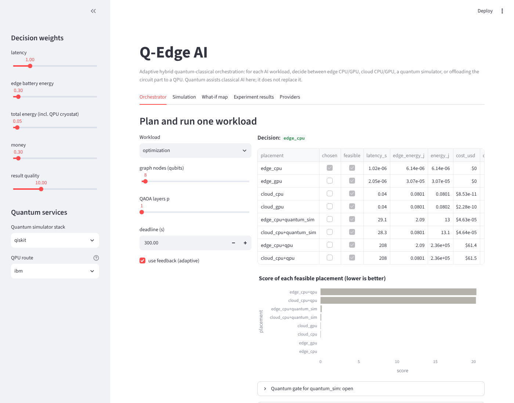
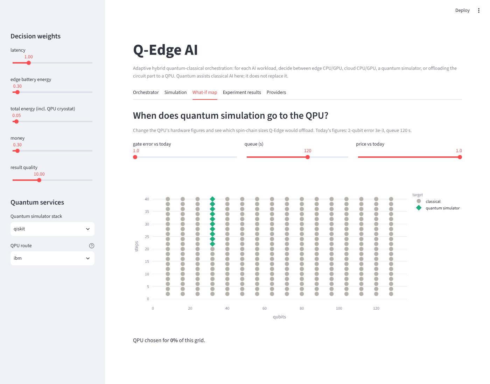

# Q-Edge AI

**Adaptive Hybrid Quantum Edge Intelligence Framework.** For every incoming AI workload, Q-Edge decides whether
to run it on the edge CPU or GPU, send it to a cloud CPU or GPU, or split it so that only the quantum circuit
part goes to a quantum simulator or a real QPU. The premise is hybrid: quantum resources *assist* classical AI
for a narrow set of sub-problems; they do not replace CPUs and GPUs, and the framework only offloads when a
measured or modelled benefit justifies the queue, noise, energy and price.

Minor project, Department of AI & Data Science (Batch 20): Manoj Kumar P, Ayaan Syed A.

## What is in the box

| Part | Where | What it does |
|---|---|---|
| Unified quantum layer | `qedge/quantum/` | One circuit format, translated to **Qiskit, PennyLane, Cirq and Amazon Braket**. Same circuits, same noise model, same bit order, so the stacks can be compared directly. |
| Real hardware adapters | `qedge/quantum/backends/ibm_backend.py`, `braket_backend.py` | IBM Quantum (Qiskit Runtime SamplerV2) and Amazon Braket devices using your own credentials; fall back to a local IBM-device emulator when none are set. |
| Calibration-aware routing | `qedge/quantum/calibration.py`, `CalibratedIBMBackend` | Reads per-qubit error rates and queue lengths for every IBM device (free, no QPU time), picks the device and physical qubits with the highest estimated success probability, feeds per-workload error figures to the cost model, detects drift, and logs live traces for the simulator. Uses calibration snapshots of 8 real IBM devices when no account is set. |
| Hybrid algorithms | `qedge/quantum/algorithms.py` | QAOA for MaxCut, quantum-kernel SVM, Trotterised spin-chain simulation, written once for every stack. |
| Workloads | `qedge/workloads.py` | Inference, training, optimisation, kernel classification, quantum simulation, with compute, data, deadline, privacy and quantum-circuit profiles. |
| Decision engine | `qedge/orchestrator/` | Cost model (latency, edge energy, total energy, money, quality), hard constraints, an explicit **quantum-benefit gate**, a weighted score, and a feedback loop that learns where reality differs from the model. |
| Live prototype | `qedge/orchestrator/engine.py`, `qedge/executor.py` | Profile, monitor, decide, execute the real payload, evaluate, feed back. |
| Simulation environment | `qedge/simulation/simulator.py` | Discrete-event simulator with hidden "true" conditions and 7 scenarios. |
| Experiments | `qedge/experiments/` | E1 stacks, E2 quantum vs classical, E3 policies, E4 decision boundaries, E5 live runs, E6 calibration-aware routing. |
| Dashboard | `dashboard/app.py` | Streamlit: plan/run a workload, see why, run simulations, explore what-if maps, browse results. |
| Report | `REPORT.md` | Research-style write-up of the results (narrative source in `docs/narrative.md`, tables generated from `results/`). |

## Quick start

```bash
python -m venv venv && source venv/bin/activate      # Windows: venv\Scripts\activate
pip install -r requirements.txt

python -m qedge status                                # which stacks / devices are usable
python -m qedge submit optimization n=8               # plan + run one workload, with the reasoning
python -m qedge submit quantum_simulation n=8 steps=4 --force cloud_cpu+qpu   # force the QPU path
python -m qedge simulate --scenario network_congested # compare 7 policies in simulation
python -m qedge experiments --quick                   # all experiments, small sizes (minutes)
python -m qedge experiments                           # full run (longer), rebuilds REPORT.md
python -m qedge calibration show                      # error rates of every IBM device (live or snapshot)
python -m qedge calibration pick quantum_simulation n=8 steps=3   # which device and qubits, and why
python -m qedge dashboard                             # opens the dashboard in your browser
pytest                                                # 73 tests
```

## Using real quantum hardware

Nothing is required: without credentials the QPU path runs on a local emulator of an IBM device (real
topology, gate set and calibrated noise) and every report says it fell back.

**IBM Quantum (free).** Create an account at <https://quantum.cloud.ibm.com> (Open Plan: 10 QPU minutes every
28 days). Copy your API key and set it in your shell, not in code:

```bash
export QISKIT_IBM_TOKEN="your key"
python -m qedge status                 # ibm should now show OK
python -m qedge submit quantum_simulation n=6 steps=3 --force cloud_cpu+qpu
```

**Amazon Braket (billed).** Configure AWS credentials as usual, then opt in to a device:

```bash
export AWS_DEFAULT_REGION=us-east-1
export BRAKET_DEVICE_ARN=arn:aws:braket:::device/quantum-simulator/amazon/sv1   # or a QPU ARN
python -m qedge submit optimization n=6 --force cloud_cpu+qpu --qpu-stack braket
```

**Calibration-aware routing (default QPU route, `ibm-auto`).** With `QISKIT_IBM_TOKEN` set, every QPU job goes
to whichever IBM device on your account gives that circuit the highest estimated success probability, on the
best qubits of that device. Reading calibration and queue data costs no QPU minutes, so you can also collect
real data for the report:

```bash
python -m qedge calibration show                      # today's error rates and queues for every device
python -m qedge calibration log --every 600 --count 144   # one day of calibration + queue snapshots
python -m qedge calibration drift                     # what got worse between the first and last snapshot
python -m qedge simulate --scenario ibm_trace         # rerun the policy comparison on the real queue trace
```

Without a token the same routing runs over calibration snapshots of eight real IBM devices that ship with
`qiskit-ibm-runtime`, and the chosen device is emulated locally with its own noise model.

Real-hardware runs are capped by `QEDGE_HW_MAX_CIRCUITS` (60) and `QEDGE_HW_MAX_SHOTS` (2000) so an experiment
cannot burn a month of free minutes or a large bill. QAOA uses 8 optimiser iterations on hardware. See
`.env.example`.

## Dashboard

`python -m qedge dashboard` opens six tabs: plan and run one workload (with every placement's predicted
latency, energy, cost, quality and the quantum-gate checks), run the simulation, a what-if map for QPU
hardware figures, the experiment results, provider status, and calibration (device error rates, the device
and qubits chosen for a workload, IBM's error map, and drift from logged traces).





## How a decision is made

1. **Workload analysis.** Size, FLOPs, memory, input data, deadline, privacy, minimum quality, and, if it has
   a quantum formulation, its circuit profile (qubits, depth, gate counts, circuits, shots, round trips).
2. **Resource monitoring.** Slot queues, CPU load, ping RTT, provider-reported QPU queue.
   With `ibm-auto`, the monitor also reads each IBM device's calibration and gives the cost model the error
   figures of the best qubit region of the best device for this workload's size.
3. **Candidate placements.** Four classical tiers, plus `host + quantum_sim` and `host + qpu` hybrids.
4. **Hard constraints.** Memory, qubit count, privacy (private data never leaves the edge).
5. **Quantum-benefit gate.** A hybrid placement is only considered if it has a formulation, fits the device,
   has estimated fidelity ≥ 0.05, is predicted to be at least as good as the best classical option, and meets
   the deadline. The dashboard and CLI print every check.
6. **Score.** `latency/deadline + edge energy + total energy + money + quality loss + penalties`, weights
   adjustable. Lowest score wins.
7. **Execute, measure, feed back.** The adaptive policy keeps a running ratio of measured to predicted
   latency and quality per workload kind and placement, and corrects future estimates.

## Honest scope

* Classical payloads run on the machine you start it on; cloud tiers add modelled network time rather than
  calling a cloud. The decision model is what is being evaluated; the payloads prove the paths run end to end.
* Real IBM and Braket adapters follow the providers' current SDKs and are exercised in this repo through their
  fallback path; they have not been run against a live account by the authors yet. Running
  `python -m qedge status` with credentials set is the first check.
* Hardware figures in the cost model are assumptions, all listed in `docs/assumptions.md`.
* Calibration-aware routing has been exercised on calibration snapshots of real devices, emulated with each
  device's own noise model. That emulation shares the calibration it is judged against, so it shows the
  routing works as designed; whether the ranking holds on live hardware (crosstalk, drift between
  calibrations) is what `python -m qedge calibration` with a token will show.
