# Q-Edge AI: when should an AI workload use a quantum processor?

*Minor project report draft. Department of Artificial Intelligence and Data Science, Batch 20:
Manoj Kumar P, Ayaan Syed A.*

## Abstract

Q-Edge AI is a working prototype of an adaptive orchestrator that places each incoming AI workload on an
edge CPU, edge GPU, cloud CPU, cloud GPU, a quantum circuit simulator, or splits it so that only the circuit
part runs on a quantum processing unit (QPU). The framework runs the same circuits on four quantum software
stacks (Qiskit, PennyLane, Cirq, Amazon Braket) through one interface, reaches real IBM Quantum and Amazon
Braket hardware with the user's own credentials, and falls back to a calibrated IBM-device emulator otherwise.
We measured the quantum paths against classical baselines instead of assuming an advantage. On today's
hardware figures the answer to the project question is clear: **classical execution wins for every workload
we tested, and the orchestrator's main value is choosing well between edge and cloud.** Across a simulated
stream of mixed workloads Q-Edge meets 94% of deadlines against 90% for the best single-objective baseline,
while using 28% less edge energy and about 1/50th of its cloud spend. Quantum offloading becomes the right
choice only in a narrow, quantified region: wide, deep quantum-simulation circuits on hardware roughly 100x
less noisy than today's, or optimisation instances where QAOA would beat the classical heuristic by about 0.24
in approximation ratio at a few dollars per task. The framework detects both regimes automatically.
When a QPU is used, *which* QPU and which qubits matter: routing each circuit by per-qubit calibration data
cut the average output error by 37% against a fixed device (2.2x median reduction, up to 17x on small
circuits) across 16 circuits on eight IBM device calibrations, and avoided broken qubit links that the
default placement walked into. Packing several small circuits side by side into one QPU job cut QPU time and
price per circuit 8x at eight circuits per job, for an emulated fidelity loss under 0.3% before
crosstalk, and racing a classical fallback against the QPU delivered a result within 0.6 s of every
deadline in the live prototype. A neural network split between the edge and a quantum classifier head
worked end to end, but the quantum head matched or trailed a classical head of the same size, and the
embedding sent off the edge still let an attacker re-identify about 14% of inputs at k = 8, so the router keeps
such models on the edge.

## 1. Problem and approach

The question from the project proposal: *given an AI workload, when should it execute locally on the CPU/GPU,
when at the edge/cloud, and when should a portion be offloaded to a QPU?*

We treat this as a placement problem with five objectives (latency against the deadline, edge battery
energy, total energy, money, and result quality) and three kinds of hard constraint (memory, qubit count,
data privacy). Quantum resources are one more option the scheduler may pick, never a default.

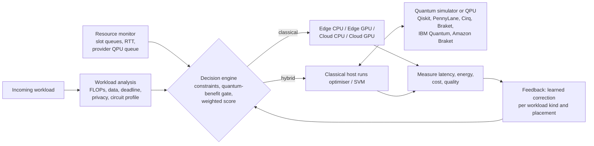

### Workloads

| Kind | Classical path | Quantum path | Quality measure |
|---|---|---|---|
| Inference (CNN batch) | edge/cloud CPU or GPU | none | accuracy |
| Training (fine-tuning) | edge/cloud CPU or GPU | none | accuracy |
| Optimisation (MaxCut) | exact enumeration ≤ 22 nodes, simulated annealing beyond | QAOA: classical optimiser + quantum circuit evaluations | best cut / optimum |
| Kernel classification | RBF-kernel SVM | quantum-kernel SVM (ZZ feature map, kernel estimated on the QPU) | test accuracy |
| Quantum simulation (transverse-field Ising chain) | exact state vector, or a bond-dimension-capped MPS beyond ~32 qubits | Trotter circuit run natively | 1 - error in magnetisation |

Only the last three have a quantum formulation; the first two are never sent to a QPU.

### Decision engine

For each candidate placement the cost model predicts latency (queue + transfer + compute, or queue +
per-round overhead + shots for quantum), edge energy (local compute plus radio), total energy (including a
QPU's 25 kW system draw while it runs), money (cloud per-second rates, QPU per-task and per-shot prices) and
quality. A hybrid placement must then pass the **quantum-benefit gate**: a quantum formulation exists, the
circuit fits the device, data may leave the edge, estimated circuit fidelity ≥ 0.05, predicted quality is at
least the best classical option's, and the deadline is met. Survivors are ranked by a weighted score; the
weights are user-adjustable in the dashboard. The adaptive variant then keeps an exponentially weighted
ratio of measured to predicted latency and quality per (workload kind, placement) and corrects later
estimates. All modelling assumptions are in `docs/assumptions.md`.

## 2. Experiments

| | Question | How |
|---|---|---|
| E1 | Do the four quantum stacks agree, and how fast are they? | 4 circuit families, 2 to 20 qubits, each on Qiskit Aer, PennyLane, Cirq and Braket; plus the same noise model in all four. |
| E2 | Does the quantum path actually help on these workloads? | QAOA vs exact/greedy/annealing on 18 random graphs (4 to 14 nodes); quantum vs RBF/logistic kernels on breast-cancer data (2 to 6 features, 4 seeds); Trotter circuits vs exact. Noiseless, NISQ-noise (p2 = 3e-3) and an IBM Torino emulator. Results calibrate the cost model. |
| E3 | Does Q-Edge place work better than simpler policies? | Discrete-event simulation, 800 mixed workloads × 3 seeds × 7 scenarios × 7 policies. The scheduler sees nominal resource figures; the simulator executes against hidden true ones. |
| E4 | Where exactly is the quantum boundary? | Decision maps over circuit size and depth for today's and better QPUs, and over a hypothetical QAOA advantage and QPU price. |
| E5 | Does the prototype run end to end? | Real payloads through the live orchestrator, and every quantum-capable job forced through classical, simulator and QPU-emulator paths. |
| E6 | Does routing by calibration data pay off? | 16 TFIM, QAOA and kernel circuits (4 to 12 qubits) on eight IBM devices: v1's fixed device and default qubits vs the device and qubits chosen from per-qubit calibration, scored against the ideal output. |
| E7 | Can the QPU's fixed costs and queue risk be managed? | Packing: up to 26 small circuits side by side in one emulated job on two devices, with and without free qubits between them and under assumed crosstalk levels. Batching and race mode: 11 policy/batching variants x 5 scenarios x 3 seeds in the simulator. Live race mode: the real orchestrator racing the QPU path against the classical fallback at deadlines either side of the QPU time. |
| E8 | Do VQE and QAOA scheduling help? | VQE (RY ansatz, Rotosolve vs COBYLA) on H2 and spin chains against exact diagonalisation, on four stacks and the IBM emulator; QAOA on an edge/cloud task-assignment QUBO against exact search, annealing and random sampling with the same sample budget; 3 seeds. |
| E9 | Should a neural network be split across edge, cloud and a quantum head, and is the split private? | A CNN on 8x8 digits with linear, MLP and quantum heads at k = 2 to 8 qubits, 3 seeds, transfer and end-to-end training; the quantum head on the emulated IBM device and in packed jobs; three reconstruction attacks on every cut; 2880 router decisions over devices, bandwidth, privacy, deadlines and QPU what-ifs. |

## 3. Results

### 3.1 One interface, four stacks (E1)

Through the shared circuit format all four SDKs produce the same distributions: up to 8 qubits the
total-variation distance to the exact state vector averages 0.03 for every stack, which is the shot-noise
level for 4000 shots, and the average-⟨Z⟩ error stays below 0.05 up to 20 qubits. With an identical
depolarising model translated into each SDK's own noise API, the noisy distributions agree with Qiskit's to
within 0.12 TV at 8 qubits (again shot-noise sized). This matters for the research comparison: differences
reported later are properties of the algorithms and hardware, not of the SDK.

Speed differs more than correctness, and the ranking flips with size. Qiskit Aer pays a fixed overhead of
about 0.12 s per call, so for small circuits PennyLane and Cirq are 5 to 10x faster; that is why the same
33-evaluation QAOA loop on 8 qubits took 0.39 s on PennyLane and 3.2 s on Qiskit (appendix A2). Past about
16 qubits the picture reverses: at 20 qubits Qiskit was fastest on the QAOA and Trotter circuits (0.36 s and
0.52 s per 4000-shot run), Cirq on GHZ and the kernel feature map (0.11 s, 0.24 s), and PennyLane's
`default.qubit` was 3 to 5x slower on the deeper circuits (1.8 to 2.0 s). Braket's local simulator sat in
between. So the simulator stack is itself a placement choice that depends on circuit size and on how many
small calls an algorithm makes; the dashboard exposes it.

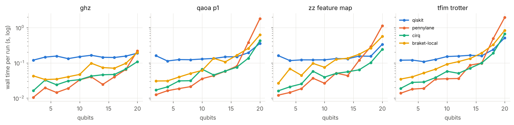

### 3.2 Quantum vs classical, measured (E2)

**MaxCut.** Taking the best of 1000 QAOA shots, QAOA "finds the optimum" on every graph up to 14 nodes,
noiseless, noisy or on the IBM emulator. So does sampling uniformly at random, to within 2%. At these sizes
1000 shots cover a large part of the 2^n solution space, so best-of-shots says nothing about the algorithm.
The informative number is the mean cut of a single sample: QAOA (p = 1) averages 0.74 of optimum against
0.65 for a random sample, closing about 39% of the gap at 4 nodes and 11% at 14 nodes. Exact enumeration
solves every instance in under 5 ms and simulated annealing matches it, so on these instances there is no
quality gap for QAOA to close. Calibrating the cost model with these measurements (instead of the
best-of-shots numbers) is what stops it from over-promising QAOA on large graphs.

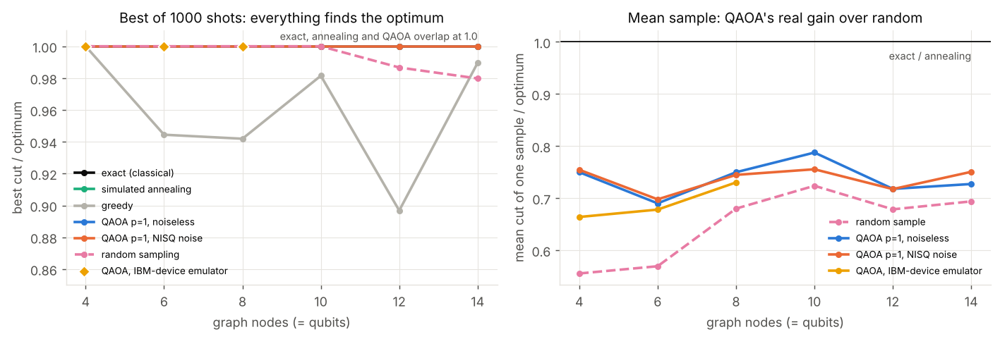

**Kernel classification.** The quantum-kernel SVM reached 0.78 to 0.85 test accuracy against 0.89 to 0.91
for an RBF SVM and 0.92 to 0.94 for logistic regression, at every feature count, and took seconds instead of
milliseconds. Realistic gate noise cost it very little (±0.03), so the gap is the feature map, not the
hardware. Without bandwidth scaling the textbook ZZ feature map did worse still (0.60 at 4 features in a pilot run);
the 1/d scaling of Shaydulin & Wild (2022) is what makes it usable, and it still trails the classical kernel.

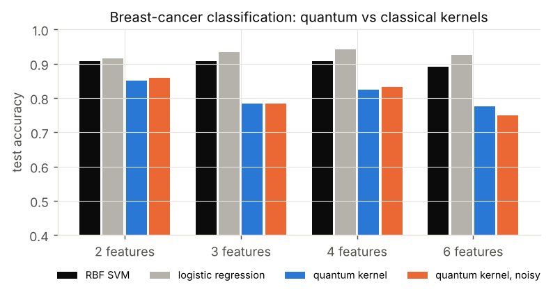

**Quantum simulation.** Trotter circuits on the noiseless simulator reproduce the exact magnetisation to
within 0.01; with NISQ-level noise the error stays below 0.03 for chains up to 12 qubits and 10 steps. These
sizes are trivially exact on a laptop's state vector in milliseconds, so the quantum path only becomes
interesting at sizes no laptop can verify, which is what E4 models.

### 3.3 Placement policies (E3)

Mixed stream: 45% inference, 10% training, 20% optimisation, 15% kernel classification, 10% quantum
simulation, Poisson arrivals. Values averaged over three seeds of 800 workloads.

| Baseline scenario | Deadlines met | Mean latency | Edge energy / task | Cloud + QPU cost / task |
|---|---|---|---|---|
| Edge only | 38% | 3 696 s | 282 J | $0.000 |
| Cloud only | 51% | 714 s | 61 J | $0.001 |
| Quantum first (offload whenever possible) | 6% | 16 695 s | 324 J | $397 |
| Random | 43% | 6 528 s | 663 J | $111 |
| Latency-greedy | 90% | 23 s | 85 J | $0.111 |
| **Q-Edge (static)** | **94%** | 25 s | **61 J** | $0.002 |
| **Q-Edge (adaptive)** | **94%** | 25 s | **61 J** | $0.002 |

Neither edge-only nor cloud-only placement works for a mixed stream: the edge drowns in training jobs, the
cloud loses latency-critical inference to upload time. Latency-greedy placement is strong on latency but
ignores energy, money and quality. Q-Edge gives up 2 s of mean latency to meet more deadlines with 28% less
edge energy and 1/50th of the spend. "Quantum first" is the cautionary baseline: sending every
quantum-capable task to a QPU costs about $400 per task at current Braket-style per-shot prices (a 120-circuit
quantum kernel needs millions of shots), meets 6% of deadlines and lowers quality.

When reality departs from the nominal model the feedback loop pays off, modestly:

| Scenario (hidden from the scheduler) | Static: deadlines / mean latency / p95 | Adaptive: deadlines / mean latency / p95 |
|---|---|---|
| Network congested (uplink at 20%) | 85.4% / 121 s / 1 018 s | **86.6% / 101 s / 769 s** |
| Edge overloaded (4x load, throttled) | 75.0% / 84 s / 660 s | **75.6% / 80 s / 603 s** |
| Future QPU whose real queue is 50x the advertised one | 93.8% / 38 s / 239 s | **94.0% / 33 s / 214 s** |

In the last scenario the adaptive policy learned the hidden queue and cut its QPU offloads from 45 to 26
tasks. When nothing is hidden (baseline, free QPU tier, QPU busy but correctly reported) static and adaptive
are within noise of each other, as they should be.

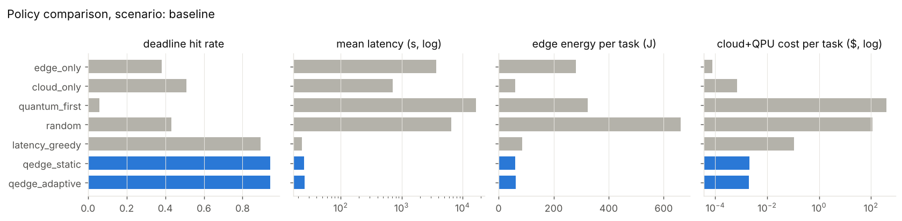

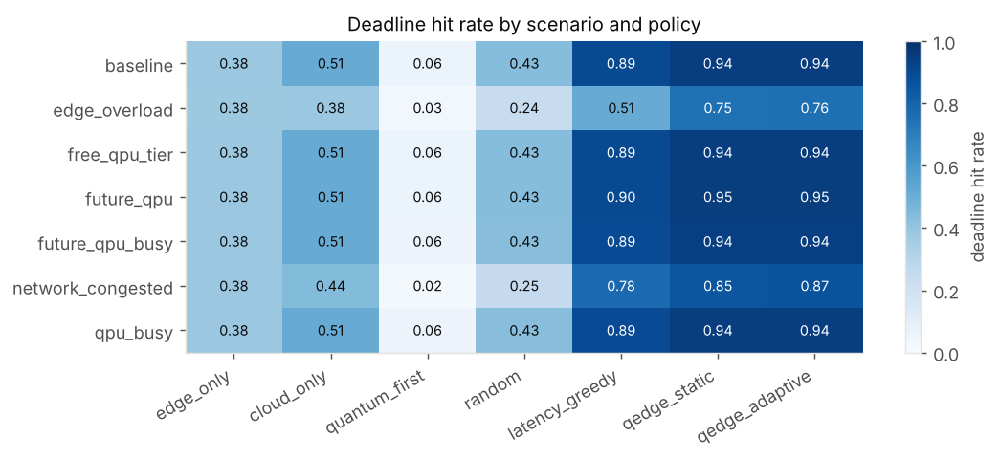

### 3.4 Where the quantum boundary lies (E4)

**Quantum simulation.** With today's error rates (2-qubit 3e-3) Q-Edge never chooses the QPU anywhere in
the grid of 8 to 128 qubits and 2 to 40 Trotter steps: circuits shallow enough to survive the noise are also
shallow enough for a classical MPS simulation, and deep ones fail the fidelity gate. A 10x better QPU still
does not change this. At 100x lower error, which is early fault-tolerant territory rather than today's
hardware, the QPU is chosen for 36% of the grid: chains of 40 qubits or more run for more than 20 steps,
where classical simulation runs out of memory or accuracy. At 32 qubits a cloud state-vector simulator
is the better option, because the circuit still fits one.

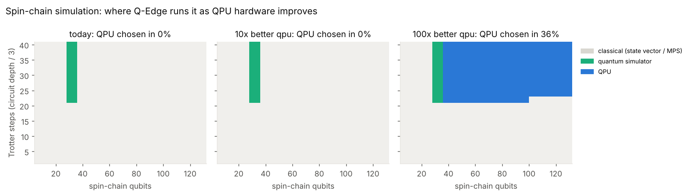

**Optimisation.** We asked how large a QAOA advantage would have to be before Q-Edge offloads, on a hard
instance class where the classical heuristic reaches only 0.70 of optimum, using the 100x-better QPU. At 30
nodes a quality edge of 0.06 is enough, but the work goes to a *simulator*, because 30 qubits still fit one.
At 60 nodes the QPU is chosen once the edge reaches about 0.24 and a task costs at most about $6; at
$25 a task it never is. At 100 nodes the routed circuit's fidelity falls to 0.22 and no edge in the sweep
justifies it.

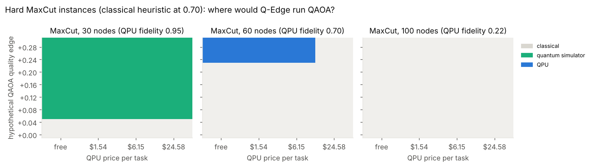

### 3.5 The prototype end to end (E5)

The live orchestrator ran ten real workloads, choosing classical placements for all of them, then ran
every quantum-capable job through the forced simulator and QPU paths. All paths completed. QAOA on the IBM
Torino emulator matched the classical optimum on 6 and 10 node graphs (at that size best-of-shots always
does, see 3.2); a Trotter circuit on the emulator came within 0.05 of the exact magnetisation, against
0.01 on the noiseless simulator. The emulator's wall time (90 to 180 s for QAOA) is the cost of simulating
the device's noise on a laptop, not a QPU time, so latency rows for it are not comparable. Predicted and measured quality agreed to within the per-run noise of
the small test sets. The full table is in appendix A7.

### 3.6 Calibration-aware routing (E6)

v1 treated "the QPU" as one device with one set of error rates. Real providers expose many devices whose
median error rates differ by about 7x and change daily, and within one chip some qubits and couplers are far worse
than the median (IBM reports broken couplers with error 1.0). Q-Edge now reads every device's per-qubit
calibration (free: it uses no QPU time), estimates each circuit's success probability (ESP) on every device
and qubit placement, and routes to the best. Without an IBM account it uses calibration snapshots of eight
real devices (three Eagle and five Heron chips) and emulates the chosen device with its own noise model.

| | v1 (Torino, default qubits) | calibration-aware routing |
|---|---|---|
| Mean output error, 16 circuits | 0.095 | 0.059 (37% lower) |
| Median error reduction per circuit | | 2.2x (range 1.1x to 17x) |
| Picked the device that measured best | | 10 of 16; worst miss 0.009 fidelity |

Three findings stand out:

* **Device choice gives most of the gain.** The router picked the same device for every circuit (Aachen, the
  snapshot with the lowest error rates), and it was the measured best or within 0.009 of it. With live data,
  queues and daily calibration changes would make the choice move between devices. Keeping Torino but choosing its qubits
  by calibration helped 13 of 16 circuits, by less.
* **Calibration catches what averages hide.** On Sherbrooke, the default placement used a broken coupler in
  7 of 16 circuits, giving fidelities of 0.38 to 0.72. Calibration-aware placement reached 0.75 to 0.98 on
  the same device.
* **Static figures cannot choose a device at all.** v1's single catalogue number predicts the same fidelity on
  every device. Per-qubit ESP ranks devices for a given circuit with a Spearman correlation of 0.88 against
  measured fidelity. It is a ranking tool rather than a quality forecast: an error-free run is sufficient
  but not necessary for a good output, so measured fidelity sits above ESP.

Qiskit's own optimisation level 3 already places qubits using average error data; our extra search over up
to 4000 placements beat it in only 9 of 128 cases, by a tiny margin. The gain over v1 comes from choosing the
device and from using that noise-aware placement, not from a better placement algorithm. Every number here
comes from emulators built from the same calibration data the router reads, so this shows the routing works
as designed; live hardware adds crosstalk and drift between calibrations, which the trace logger
(`python -m qedge calibration log`) is built to measure.

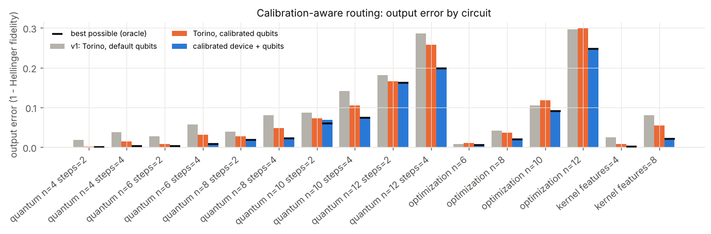

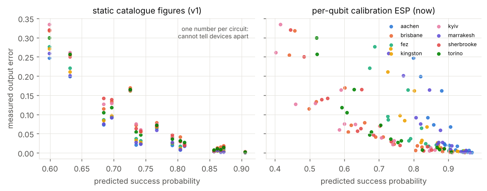

### 3.7 Sharing QPU jobs and racing a classical fallback (E7)

Every QPU job pays a queue wait and fixed charges, and a 4-qubit circuit uses about 3% of a 133-156 qubit
chip. E7 tests three ways to manage that, all on top of the calibration-aware routing of 3.6.

**Packing several clients' circuits into one job.** Q-Edge places each circuit on its own best region of
the chip, optionally leaving a ring of unused qubits around each so programs never touch, runs them as one
circuit with one set of shots, and splits the results. The chip held up to 20 4-qubit programs on Aachen
and 18 on Torino with the free ring, or 26 and 22 without it.

| 4-qubit TFIM programs, 4000 shots | alone | 8 per job | full chip |
|---|---|---|---|
| QPU seconds per program | 1.11 | 0.139 | 0.043 to 0.050 |
| Braket-style price per program | $6.10 | $0.76 | $0.23 to $0.28 |
| Programs per 10 free IBM minutes | 540 | 4321 | 11 883 to 14 043 |

The cost is quality. Up to four programs per job the fidelity loss is lost in shot noise everywhere. At
eight it is resolved only on the noisier Torino with mixed programs (0.3% without assumed crosstalk). With the chip full it reaches
0.6-0.7% on Torino and 0.1% on Aachen with the free ring. Crosstalk is not in the emulator, so we added it
as an assumption: multiplying the error of two-qubit gates next to another program by 2 or 5 raises the
full-chip loss on Torino to 0.8-2.0%, and the free ring removes it by construction at the price of fewer
programs per job. On real hardware, crosstalk and idle time while the longest program finishes would add
to these numbers.

**Batching in the scheduler.** In simulation, QPU tasks arriving within a window share a job. This only
pays when many tasks go to the QPU: with a quantum-heavy future workload, a 30 s window cut QPU charges per
task by 19% (shared shots; 7% under a strict all-or-nothing packing rule) while QPU tasks waited 51 s instead
of 30 s, and a 120 s window cut 28% (1.5% under the strict rule) at 109 s. Where few tasks reach the QPU,
windows of 30 s or less changed cost by under 0.2%. Batching never raised the deadline hit rate by more than 0.1 point.

**Race mode.** When a QPU job risks its deadline, Q-Edge also runs the best classical placement and keeps
the QPU result only if it arrives in time, cancelling the QPU job otherwise. In the simulated busy-QPU
scenario, where the provider under-reports its queue, this lifted the deadline hit rate of QPU tasks from
77% to 89% and cut QPU charges per task by 18%, because jobs cancelled while still queued cost nothing; the
extra classical runs cost $0.0001 and 43 J per task. Where the provider's queue estimate is unbiased it never triggered at the default threshold.
In the live prototype, the QPU result was delivered when it beat the deadline (twice), and otherwise the
classical result arrived at the deadline with the QPU job cancelled (eight times). Because the emulator
shares the machine with the fallback, delivery overshot the deadline by up to 0.55 s; on real hardware the
QPU side is a network wait.

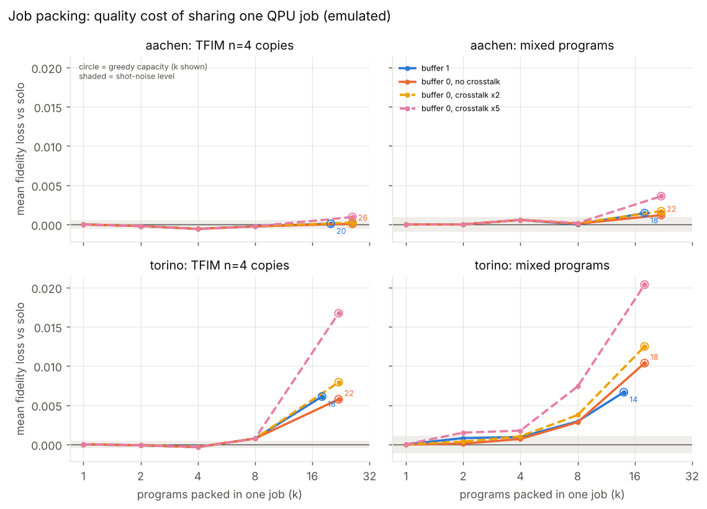

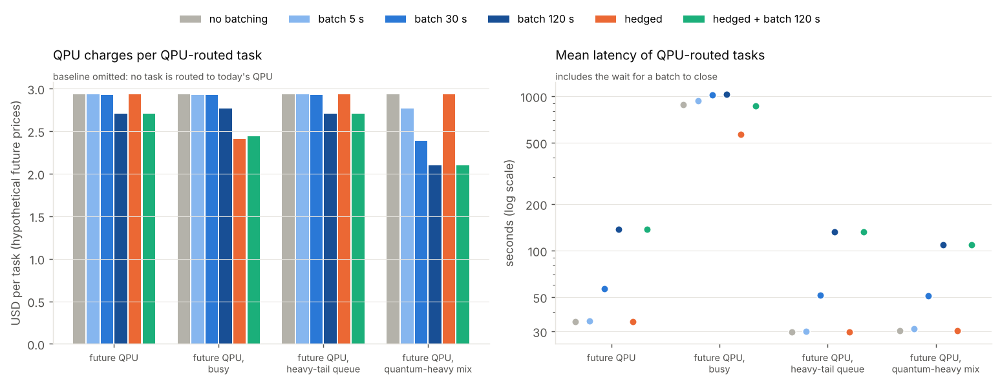

### 3.8 VQE and QAOA task scheduling (E8)

Two further hybrid algorithms were added. VQE estimates the ground-state energy of the hydrogen molecule and of the
transverse-field Ising chain, using a hardware-efficient RY ansatz trained with Rotosolve. Noiselessly, it reaches the
exact energy to within about 1 to 3 % of the spectral width, which beats COBYLA at the same budget. QAOA was also
applied to Q-Edge's own placement problem: assigning tasks to edge or cloud as a QUBO. At up to 14 tasks it finds
the optimum, but random sampling with the same number of samples does too, so the decision engine is calibrated
to expect no quality gain from it. Exact diagonalisation and exact search remain faster at these sizes, so the
engine keeps both workloads classical. Tables are in appendices A12 and A13.

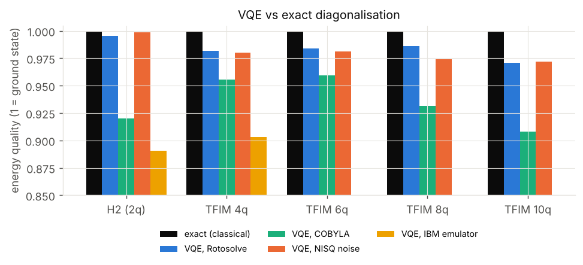

### 3.9 A neural network split across edge, cloud and QPU (E9)

The realistic way quantum touches AI today is as a small layer inside a classical model, so E9 builds one and
lets the router decide where to cut it. A small CNN on 8x8 digit images runs on the edge and compresses each
image into k numbers (k = 2 to 8). The head that classifies those numbers is a linear layer, a small MLP with
about as many parameters as the quantum head, or a k-qubit variational circuit (angle encoding, two trainable
layers, a CNOT ring, a linear readout of the k expectation values). The quantum head is trained with
PennyLane's autograd backpropagation, and the same weights export to the framework's circuit format, so it
runs on every stack, the calibrated IBM emulator and packed QPU jobs. Every number below is the mean over
three training seeds on the same 360 test images. PyTorch is not used: the backbone is written in autograd.

**Accuracy.** The quantum head never beat the classical heads on average.

| k (qubits) | linear | MLP | quantum, 2 layers | quantum, 0 layers |
|---|---|---|---|---|
| 4 | 0.950 | 0.944 | 0.931 | 0.948 |
| 8 | 0.975 | 0.963 | 0.919 | 0.969 |

Paired by seed, quantum minus linear is between -0.014 (k = 3) and -0.065 (k = 7), and the quantum head was
ahead in 1 of 21 seed-and-size pairs. The trained circuit also loses to its own zero-layer ablation (the
encoding and readout alone) at every k from 4 to 8, so the trainable circuit adds nothing measurable here.
Training the CNN and the quantum head jointly, so that the embedding is not shaped for a linear head, did not
help: 0.843 (with a large spread between seeds) against 0.954 for linear at k = 4. With 1000 shots the
quantum head matched its exact accuracy to within 0.003. On the emulated best IBM device (Aachen) it scored
0.944 at k = 4, the same as exact; packing 16 test images per QPU job kept 0.942 and cut the modelled QPU time
from 105 s to 6.6 s for 360 images. The cost model's quantum-head quality was pessimistic by 0.03 at k = 4
and by 0.07 to 0.11 at k = 8, so it never favours the quantum head unfairly.

**Privacy, measured instead of assumed.** "Raw data never leaves the edge, only an 8-number embedding does"
sounds private, so we attacked it. An attacker who sees the transmitted tensor and has similar labelled
images trains a decoder (ridge, MLP or nearest neighbours) and tries to re-identify each test image among
all 360. The raw input and the first conv layer re-identify every image, the second conv layer 83 to 93%,
and the k-number embedding 3.4% (k = 2) to 13.6% (k = 8). Chance is 0.28%, and knowing the predicted label
alone gives 2.8%. Up to 52 images were re-identified beyond what the label gives, against a policy limit of
5 (five times chance). So **no cut passes the privacy test at any k**, and the router keeps private
workloads entirely on the edge. This is against these three attacks, not a guarantee; a stronger attack
could only find more.

**Where the router cuts.** Across 2880 router decisions (two profiles, three edge devices, uplinks from 1 to
1000 Mbps, privacy on and off, single images and batches of 32, real-time and batch deadlines, today's and a
future QPU, two policies), it chose edge-only 2544 times and uploading the raw image to a cloud GPU 336
times. It never chose a split or the quantum head. For the digits model the head after the embedding is
80 FLOPs, so nothing is worth sending. For a camera-sized model (MobileNetV2 figures, an assumption) a slow
edge with a fast link goes to the cloud, but every intermediate activation is larger than the useful
saving. Even when we assumed the quantum head as accurate as the best classical head on a 100x better and
cheaper QPU, the gate opened but the edge still won on score. The value of this part of Q-Edge is that the
split, the head and the privacy claim are now decisions made from measurements, and today they all point
to the edge.

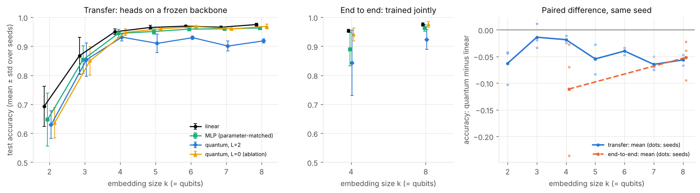

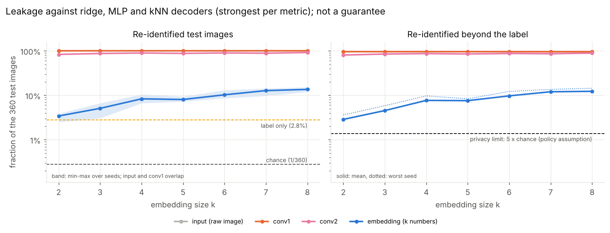

## 4. Answer to the project question

* **Run locally on the edge CPU/GPU** when the data are private, the deadline is tight relative to upload
  time, or the job is small: most inference, small optimisation and kernel jobs.
* **Send to the cloud CPU/GPU** when compute dominates transfer: training, large inference batches, and
  quantum-circuit simulation up to about 32 qubits.
* **Offload a portion to a QPU** only when all of these hold: the task has a quantum formulation, its circuit
  fits and keeps a usable fidelity on the device, the quantum result is predicted to beat the best classical
  result, and queue, price and energy still fit the deadline and budget. On today's hardware none of our
  workloads met that bar; E4 maps where future hardware would.
* **When a QPU is used, route by calibration.** Pick the device and qubits from today's per-qubit error data,
  not a fixed device: E6 shows a 37% lower average output error and avoids broken couplers.
* **Share and hedge QPU jobs.** Pack small circuits from several clients into one job (8x cheaper per
  circuit at eight per job for under 0.3% fidelity in emulation), and race a classical fallback when the
  queue might break the deadline.
* **Treat a quantum classifier head as an experiment, not a deployment.** In E9 it matched or trailed a
  classical head of the same size, and the k-number embedding it reads still re-identified 3 to 14% of
  inputs, so private inference stays on the edge.

That conclusion is the framework working as intended. The value of Q-Edge is that the decision is explicit,
measured and re-evaluated as hardware improves: changing three numbers in the configuration (error rate,
queue, price) moves the boundary, and the dashboard shows it moving.

## 5. Limitations

* Classical payloads run on one machine; cloud tiers add modelled network time rather than calling a cloud.
  Resource figures are assumptions listed in `docs/assumptions.md`.
* The IBM Quantum and Amazon Braket adapters follow the current SDKs but have not yet been run against a
  live account; all QPU results here come from the IBM Torino emulator. Running the E5 jobs with
  `QISKIT_IBM_TOKEN` set is the next step and fits within the free Open Plan.
* QAOA was run at p = 1 with 25 optimiser iterations; deeper circuits and better optimisers could close more of
  the gap to the optimum, though not past the exact and annealing baselines on these instance sizes.
* The MPS quality model for classical simulation beyond 32 qubits is the least-grounded assumption. It
  decides where the E4 boundary sits, so that boundary should be read as indicative.
* E6 judges routing on emulators built from the same calibration snapshots the router reads, so it cannot show
  crosstalk or drift. The snapshots are from different dates (2025 to 2026), so the comparison is between
  device calibrations as published, not a same-day comparison. Device queues are only known with a live
  account; without one the router ranks on error rates alone.
* E7's packing results come from emulators that model no crosstalk and no idle time; crosstalk enters only as
  an assumed factor. Batching and simulated race mode use the hypothetical future QPU of E3, assume packing
  costs no fidelity, and assume a job cancelled while queued is not charged. Live race timings share one
  machine between both paths.
* E9 uses one small image task (8x8 digits) and one model family; the camera profile's FLOPs and activation
  sizes are architecture figures, not a trained model, and its privacy verdict is inherited from digits. The
  privacy test covers three decoders only. The quantum head was run on emulated devices, not real hardware.
* Small test sets in the live runs (10 to 30 points) make single-run accuracies noisy; E2 is the place for
  statistical comparison.

## 6. How to reproduce

```bash
pip install -r requirements.txt
pytest                                   # 259 tests
python -m qedge experiments              # every experiment, then REPORT.md
python -m qedge dashboard
```

---

# Appendix: generated result tables

Generated from `results/` by `python -m qedge report`. Run settings: `{"quick": false, "python": "3.13.16", "machine": "x86_64", "versions": {"qiskit": "2.5.2", "qiskit_aer": "0.17.2", "pennylane": "0.45.1", "cirq": "1.7.0", "amazon-braket-sdk": "1.127.3.post0"}, "timings_s": {"e2": 1299.7, "e1": 362.7, "e3": 18.2, "e4": 0.4, "e5": 290.7, "e6": 1261.7, "e7_packing": 331.0, "e7_batching": 27.0, "e9": 2397.3}}`

## A1. Stack agreement and speed (E1)

Agreement with the exact state vector (4000 shots). Total-variation distance is only meaningful while 4000 shots can cover the outcomes (up to 8 qubits); the average-<Z> error is checked at every size up to 20 qubits:

| stack | mean_tv_to_exact_n_le_8 | max_tv_to_exact_n_le_8 | max_mean_z_error_all_n |
|---|---|---|---|
| braket-local | 0.030 | 0.084 | 0.041 |
| cirq | 0.030 | 0.088 | 0.026 |
| pennylane | 0.030 | 0.086 | 0.032 |
| qiskit | 0.029 | 0.080 | 0.032 |

Wall time (s) per run at 20 qubits:

| family | braket-local | cirq | pennylane | qiskit |
|---|---|---|---|---|
| ghz | 0.199 | 0.109 | 0.220 | 0.188 |
| qaoa_p1 | 0.622 | 0.424 | 1.792 | 0.356 |
| tfim_trotter | 0.839 | 0.662 | 1.953 | 0.517 |
| zz_feature_map | 0.564 | 0.243 | 1.133 | 0.338 |

Same depolarising noise model in all four SDKs, TV distance to Qiskit's noisy result:

| n_qubits | braket-local | cirq | pennylane | qiskit |
|---|---|---|---|---|
| 2 | 0.016 | 0.017 | 0.007 | 0.000 |
| 4 | 0.034 | 0.025 | 0.040 | 0.000 |
| 6 | 0.058 | 0.059 | 0.068 | 0.000 |
| 8 | 0.124 | 0.119 | 0.120 | 0.000 |


## A2. MaxCut: QAOA vs classical (E2)

Mean best-cut / optimum:

| n | exact | greedy | qaoa_ibm_emulator | qaoa_noiseless | qaoa_noisy | random_sampling | simulated_annealing |
|---|---|---|---|---|---|---|---|
| 4 | 1.000 | 1.000 | 1.000 | 1.000 | 1.000 | 1.000 | 1.000 |
| 6 | 1.000 | 0.944 | 1.000 | 1.000 | 1.000 | 1.000 | 1.000 |
| 8 | 1.000 | 0.942 | 1.000 | 1.000 | 1.000 | 1.000 | 1.000 |
| 10 | 1.000 | 0.981 | - | 1.000 | 1.000 | 1.000 | 1.000 |
| 12 | 1.000 | 0.897 | - | 1.000 | 1.000 | 0.987 | 1.000 |
| 14 | 1.000 | 0.990 | - | 1.000 | 1.000 | 0.980 | 1.000 |

Mean cut of a single sample / optimum (what QAOA changes; best-of-shots hides it):

| n | random_sample | qaoa_ibm_emulator | qaoa_noiseless | qaoa_noisy |
|---|---|---|---|---|
| 4 | 0.556 | 0.664 | 0.750 | 0.755 |
| 6 | 0.569 | 0.678 | 0.690 | 0.698 |
| 8 | 0.680 | 0.730 | 0.750 | 0.745 |
| 10 | 0.724 | - | 0.788 | 0.756 |
| 12 | 0.679 | - | 0.718 | 0.718 |
| 14 | 0.694 | - | 0.727 | 0.751 |

Mean wall time (s):

| n | exact | greedy | qaoa_ibm_emulator | qaoa_noiseless | qaoa_noisy | random_sampling | simulated_annealing |
|---|---|---|---|---|---|---|---|
| 4 | 0.0001 | 0.0001 | 62.2340 | 4.0147 | 2.2264 | 0.0000 | 0.0077 |
| 6 | 0.0002 | 0.0000 | 54.5036 | 4.2402 | 2.2112 | 0.0000 | 0.0091 |
| 8 | 0.0002 | 0.0001 | 55.9040 | 4.1388 | 3.1814 | 0.0000 | 0.0107 |
| 10 | 0.0005 | 0.0001 | - | 4.3509 | 15.4185 | 0.0000 | 0.0172 |
| 12 | 0.0009 | 0.0001 | - | 4.2790 | 40.1757 | 0.0000 | 0.0161 |
| 14 | 0.0037 | 0.0001 | - | 4.8881 | 144.6642 | 0.0000 | 0.0273 |

The same QAOA run on every stack:

| stack | n | best_ratio | expected_ratio | circuit_evals | time_s |
|---|---|---|---|---|---|
| qiskit | 8 | 1.000 | 0.747 | 33 | 3.162 |
| pennylane | 8 | 1.000 | 0.744 | 33 | 0.391 |
| cirq | 8 | 1.000 | 0.745 | 33 | 0.472 |
| braket-local | 8 | 1.000 | 0.745 | 33 | 1.276 |


## A3. Kernel classification (E2)

| features | logistic | quantum_kernel_noiseless | quantum_kernel_noisy | rbf_svm |
|---|---|---|---|---|
| 2 | 0.917 | 0.850 | 0.858 | 0.908 |
| 3 | 0.933 | 0.783 | 0.783 | 0.908 |
| 4 | 0.942 | 0.825 | 0.833 | 0.908 |
| 6 | 0.925 | 0.775 | 0.750 | 0.892 |


## A4. Spin-chain simulation error (E2)

Absolute error in average magnetisation vs exact:

| n | steps | classical_statevector | ibm_emulator | sim_noiseless | sim_noisy |
|---|---|---|---|---|---|
| 4 | 2 | 0.000 | 0.089 | 0.002 | 0.002 |
| 4 | 5 | 0.000 | 0.000 | 0.003 | 0.009 |
| 4 | 10 | 0.000 | 0.005 | 0.007 | 0.006 |
| 6 | 2 | 0.000 | 0.088 | 0.001 | 0.000 |
| 6 | 5 | 0.000 | 0.015 | 0.004 | 0.027 |
| 6 | 10 | 0.000 | 0.000 | 0.011 | 0.002 |
| 8 | 2 | 0.000 | 0.071 | 0.007 | 0.007 |
| 8 | 5 | 0.000 | 0.014 | 0.002 | 0.010 |
| 8 | 10 | 0.000 | 0.007 | 0.005 | 0.003 |
| 10 | 2 | 0.000 | - | 0.002 | 0.014 |
| 10 | 5 | 0.000 | - | 0.003 | 0.013 |
| 10 | 10 | 0.000 | - | 0.001 | 0.006 |
| 12 | 2 | 0.000 | - | 0.004 | 0.010 |
| 12 | 5 | 0.000 | - | 0.003 | 0.010 |
| 12 | 10 | 0.000 | - | 0.004 | 0.009 |

Calibration written for the cost model: `{"qaoa_gain": {"a": 1.7478396420712126, "b": 1.0103692179236266}, "opt_c": 0.554034699612686, "sa_ratio": {"slope": 0.0, "at": 8, "value": 1.0, "floor": 0.95}, "kernel_acc": {"quantum": 0.8083333333333333, "rbf": 0.9041666666666667}, "vqe_quality": {"slope": -0.00226845393672063, "at": 2, "value": 0.9956664771862939, "floor": 0.85}, "sched_random": {"slope": -0.014487121616236158, "at": 10, "value": 1.0, "floor": 0.1}, "sched_sa": {"slope": 0.0, "at": 10, "value": 1.0, "floor": 0.9}, "sched_qaoa_advantage": 0.0}`

## A5. Policy comparison (E3)

| scenario | policy | deadline_hit_rate | mean_latency_s | p95_latency_s | edge_energy_j | total_energy_kj | cost_usd_per_task | mean_quality | quantum_offload_rate |
|---|---|---|---|---|---|---|---|---|---|
| baseline | cloud_only | 0.509 | 714.299 | 3637.361 | 60.984 | 0.357 | 0.001 | 0.970 | 0.000 |
| baseline | edge_only | 0.383 | 3696.425 | 11426.606 | 281.571 | 0.318 | 0.000 | 0.970 | 0.000 |
| baseline | latency_greedy | 0.895 | 23.053 | 192.558 | 85.012 | 1.018 | 0.111 | 0.968 | 0.006 |
| baseline | qedge_adaptive | 0.943 | 25.336 | 202.947 | 61.358 | 0.817 | 0.002 | 0.971 | 0.025 |
| baseline | qedge_static | 0.944 | 25.114 | 202.947 | 61.298 | 0.848 | 0.002 | 0.971 | 0.007 |
| baseline | quantum_first | 0.060 | 16695.109 | 62480.495 | 323.890 | 1869.670 | 396.528 | 0.865 | 0.429 |
| baseline | random | 0.432 | 6527.898 | 33811.056 | 662.738 | 533.823 | 110.906 | 0.936 | 0.191 |
| edge_overload | cloud_only | 0.381 | 1576.901 | 5895.793 | 81.364 | 0.378 | 0.001 | 0.970 | 0.000 |
| edge_overload | edge_only | 0.375 | 7922.825 | 23957.305 | 469.285 | 0.505 | 0.000 | 0.970 | 0.000 |
| edge_overload | latency_greedy | 0.509 | 276.655 | 973.216 | 117.973 | 3.258 | 0.466 | 0.961 | 0.021 |
| edge_overload | qedge_adaptive | 0.756 | 80.489 | 602.875 | 84.227 | 1.156 | 0.003 | 0.971 | 0.028 |
| edge_overload | qedge_static | 0.750 | 83.683 | 660.269 | 83.989 | 1.232 | 0.003 | 0.971 | 0.018 |
| edge_overload | quantum_first | 0.029 | 18850.187 | 65103.767 | 519.545 | 1869.866 | 396.528 | 0.865 | 0.429 |
| edge_overload | random | 0.239 | 11584.611 | 56911.980 | 1094.870 | 534.255 | 110.906 | 0.936 | 0.191 |
| free_qpu_tier | cloud_only | 0.509 | 714.299 | 3637.361 | 60.984 | 0.357 | 0.001 | 0.970 | 0.000 |
| free_qpu_tier | edge_only | 0.383 | 3696.425 | 11426.606 | 281.571 | 0.318 | 0.000 | 0.970 | 0.000 |
| free_qpu_tier | latency_greedy | 0.895 | 23.053 | 192.558 | 85.012 | 1.018 | 0.001 | 0.968 | 0.006 |
| free_qpu_tier | qedge_adaptive | 0.943 | 25.336 | 202.947 | 61.358 | 0.817 | 0.002 | 0.971 | 0.025 |
| free_qpu_tier | qedge_static | 0.944 | 25.114 | 202.947 | 61.298 | 0.848 | 0.002 | 0.971 | 0.007 |
| free_qpu_tier | quantum_first | 0.060 | 16695.109 | 62480.495 | 323.890 | 1869.670 | 0.000 | 0.865 | 0.429 |
| free_qpu_tier | random | 0.432 | 6527.898 | 33811.056 | 662.738 | 533.823 | 0.007 | 0.936 | 0.191 |
| future_qpu | cloud_only | 0.509 | 714.299 | 3637.361 | 60.984 | 0.357 | 0.001 | 0.970 | 0.000 |
| future_qpu | edge_only | 0.383 | 3696.425 | 11426.606 | 281.571 | 0.318 | 0.000 | 0.970 | 0.000 |
| future_qpu | latency_greedy | 0.895 | 22.401 | 190.392 | 85.012 | 1.851 | 0.029 | 0.972 | 0.012 |
| future_qpu | qedge_adaptive | 0.945 | 22.586 | 168.476 | 61.355 | 3.539 | 0.057 | 0.979 | 0.045 |
| future_qpu | qedge_static | 0.946 | 22.812 | 177.098 | 61.295 | 3.531 | 0.056 | 0.979 | 0.025 |
| future_qpu | quantum_first | 0.060 | 16649.610 | 62463.750 | 323.890 | 1869.670 | 39.653 | 0.959 | 0.429 |
| future_qpu | random | 0.432 | 6513.614 | 33781.869 | 662.738 | 533.823 | 11.097 | 0.964 | 0.191 |
| future_qpu_busy | cloud_only | 0.509 | 714.299 | 3637.361 | 60.984 | 0.357 | 0.001 | 0.970 | 0.000 |
| future_qpu_busy | edge_only | 0.383 | 3696.425 | 11426.606 | 281.571 | 0.318 | 0.000 | 0.970 | 0.000 |
| future_qpu_busy | latency_greedy | 0.892 | 27.883 | 229.809 | 85.012 | 1.851 | 0.029 | 0.972 | 0.013 |
| future_qpu_busy | qedge_adaptive | 0.940 | 33.191 | 213.642 | 61.357 | 2.446 | 0.034 | 0.976 | 0.034 |
| future_qpu_busy | qedge_static | 0.938 | 37.742 | 239.347 | 61.295 | 3.531 | 0.056 | 0.979 | 0.027 |
| future_qpu_busy | quantum_first | 0.057 | 16897.327 | 62840.437 | 323.890 | 1869.670 | 39.653 | 0.959 | 0.429 |
| future_qpu_busy | random | 0.429 | 6591.384 | 33811.181 | 662.738 | 533.823 | 11.097 | 0.964 | 0.191 |
| network_congested | cloud_only | 0.438 | 7106.144 | 28865.236 | 181.686 | 0.478 | 0.001 | 0.970 | 0.000 |
| network_congested | edge_only | 0.383 | 3696.425 | 11426.606 | 281.572 | 0.318 | 0.000 | 0.970 | 0.000 |
| network_congested | latency_greedy | 0.776 | 72.882 | 466.205 | 147.384 | 2.864 | 0.441 | 0.960 | 0.022 |
| network_congested | qedge_adaptive | 0.866 | 101.242 | 769.263 | 147.585 | 1.391 | 0.003 | 0.970 | 0.021 |
| network_congested | qedge_static | 0.854 | 121.027 | 1018.047 | 155.264 | 1.736 | 0.004 | 0.970 | 0.016 |
| network_congested | quantum_first | 0.023 | 21911.707 | 62480.626 | 444.592 | 1869.791 | 396.528 | 0.865 | 0.429 |
| network_congested | random | 0.252 | 6915.767 | 33811.181 | 720.322 | 533.880 | 110.906 | 0.936 | 0.191 |
| qpu_busy | cloud_only | 0.509 | 714.299 | 3637.361 | 60.984 | 0.357 | 0.001 | 0.970 | 0.000 |
| qpu_busy | edge_only | 0.383 | 3696.425 | 11426.606 | 281.571 | 0.318 | 0.000 | 0.970 | 0.000 |
| qpu_busy | latency_greedy | 0.893 | 23.813 | 203.142 | 85.182 | 0.510 | 0.001 | 0.970 | 0.003 |
| qpu_busy | qedge_adaptive | 0.943 | 25.311 | 202.947 | 61.358 | 0.811 | 0.002 | 0.971 | 0.025 |
| qpu_busy | qedge_static | 0.944 | 25.118 | 202.947 | 61.298 | 0.848 | 0.002 | 0.971 | 0.008 |
| qpu_busy | quantum_first | 0.056 | 17150.099 | 63674.808 | 323.890 | 1869.670 | 396.528 | 0.865 | 0.429 |
| qpu_busy | random | 0.428 | 6670.741 | 33811.181 | 662.738 | 533.823 | 110.906 | 0.936 | 0.191 |


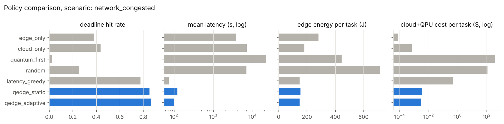


## A6. Decision boundaries (E4)

| regime | qpu_share | any_quantum |
|---|---|---|
| 100x_better_qpu | 0.362 | 0.394 |
| 10x_better_qpu | 0.000 | 0.031 |
| today | 0.000 | 0.031 |


## A7. Live prototype runs (E5)

| tag | kind | params | placement | method | backend | fallback_from | predicted_quality | quality | predicted_latency_s | measured_latency_s | predicted_cost_usd | error |
|---|---|---|---|---|---|---|---|---|---|---|---|---|
| orchestrator | inference | {'batch': 4} | edge_gpu | mlp | - | - | 1 | 1 | 0.012 | 0.00085 | 0 | - |
| orchestrator | inference | {'batch': 16} | edge_gpu | mlp | - | - | 1 | 1 | 0.0368 | 0.00105 | 0 | - |
| orchestrator | training | {'samples': 800} | edge_gpu | mlp-sgd | - | - | 1 | 0.817 | 1.41 | 0.0945 | 0 | - |
| orchestrator | optimization | {'n': 6} | edge_cpu | exact enumeration | - | - | 1 | 1 | 1.28e-07 | 4.84e-05 | 0 | - |
| orchestrator | optimization | {'n': 10} | edge_cpu | exact enumeration | - | - | 1 | 1 | 8.55e-05 | 0.000191 | 0 | - |
| orchestrator | optimization | {'n': 30} | edge_cpu | simulated annealing | - | - | 1 | 1 | 0.0283 | 0.0864 | 0 | - |
| orchestrator | kernel_classification | {'features': 2, 'n_train': 30} | edge_cpu | RBF-SVM | - | - | 0.904 | 1 | 0.00565 | 0.00292 | 0 | - |
| orchestrator | kernel_classification | {'features': 4, 'n_train': 30} | edge_cpu | RBF-SVM | - | - | 0.928 | 0.9 | 0.00993 | 0.00274 | 0 | - |
| orchestrator | quantum_simulation | {'n': 6, 'steps': 4} | edge_gpu | state vector | - | - | 1 | 1 | 8.52e-08 | 0.00064 | 0 | - |
| orchestrator | quantum_simulation | {'n': 12, 'steps': 8} | edge_gpu | state vector | - | - | 1 | 1 | 0.000645 | 0.0216 | 0 | - |
| forced:edge_cpu | optimization | {'n': 6} | edge_cpu | exact enumeration | - | - | 1 | 1 | 5.77e-06 | 3.42e-05 | 0 | - |
| forced:cloud_cpu+quantum_sim | optimization | {'n': 6} | cloud_cpu+quantum_sim | QAOA | qiskit-aer | - | 1 | 1 | 28.3 | 3.52 | 4.64e-05 | - |
| forced:cloud_cpu+qpu | optimization | {'n': 6} | cloud_cpu+qpu | QAOA | ibm-emulator:FakeTorino | ibm | 1 | 1 | 208 | 88.6 | 61.5 | - |
| forced:edge_cpu | optimization | {'n': 10} | edge_cpu | exact enumeration | - | - | 1 | 1 | 0.000282 | 0.000161 | 0 | - |
| forced:cloud_cpu+quantum_sim | optimization | {'n': 10} | cloud_cpu+quantum_sim | QAOA | qiskit-aer | - | 1 | 1 | 22.1 | 4.12 | 4.64e-05 | - |
| forced:cloud_cpu+qpu | optimization | {'n': 10} | cloud_cpu+qpu | QAOA | ibm-emulator:FakeTorino | ibm | 1 | 1 | 178 | 181 | 61.5 | - |
| forced:edge_cpu | kernel_classification | {'features': 2, 'n_train': 30} | edge_cpu | RBF-SVM | - | - | 0.921 | 0.8 | 0.00253 | 0.00261 | 0 | - |
| forced:cloud_cpu+quantum_sim | kernel_classification | {'features': 2, 'n_train': 30} | cloud_cpu+quantum_sim | quantum-kernel SVM | qiskit-aer | - | 0.808 | 1 | 2.13 | 1.98 | 0.000459 | - |
| forced:edge_cpu | kernel_classification | {'features': 4, 'n_train': 30} | edge_cpu | RBF-SVM | - | - | 0.891 | 1 | 0.0051 | 0.0037 | 0 | - |
| forced:cloud_cpu+quantum_sim | kernel_classification | {'features': 4, 'n_train': 30} | cloud_cpu+quantum_sim | quantum-kernel SVM | qiskit-aer | - | 0.856 | 0.9 | 2.09 | 2.94 | 0.000459 | - |
| forced:edge_cpu | quantum_simulation | {'n': 6, 'steps': 4} | edge_cpu | state vector | - | - | 1 | 1 | 7.64e-05 | 0.000901 | 0 | - |
| forced:cloud_cpu+quantum_sim | quantum_simulation | {'n': 6, 'steps': 4} | cloud_cpu+quantum_sim | Trotter circuit | qiskit-aer | - | 1 | 0.991 | 2.07 | 0.162 | 2.5e-05 | - |
| forced:cloud_cpu+qpu | quantum_simulation | {'n': 6, 'steps': 4} | cloud_cpu+qpu | Trotter circuit | ibm-emulator:FakeTorino | ibm | 0.804 | 0.952 | 110 | 3.52 | 29.3 | - |
| forced:edge_cpu | quantum_simulation | {'n': 12, 'steps': 8} | edge_cpu | state vector | - | - | 1 | 1 | 0.0304 | 0.0261 | 0 | - |
| forced:cloud_cpu+quantum_sim | quantum_simulation | {'n': 12, 'steps': 8} | cloud_cpu+quantum_sim | Trotter circuit | qiskit-aer | - | 0.998 | 0.994 | 1.59 | 0.26 | 2.5e-05 | - |
## A8. Calibration-aware routing (E6)

Data: calibration snapshots of real IBM devices (local emulation of each device). Output error = 1 - Hellinger fidelity to the ideal distribution, 4000 shots.

| case | n_qubits | v1_error | calibrated_error | calibrated_device | oracle_device | picked_oracle | static_pred | calibrated_esp |
|---|---|---|---|---|---|---|---|---|
| quantum n=4 steps=2 | 4 | 0.018 | 0.001 | fake_aachen | fake_marrakesh | False | 0.906 | 0.967 |
| quantum n=4 steps=4 | 4 | 0.038 | 0.004 | fake_aachen | fake_marrakesh | False | 0.872 | 0.951 |
| quantum n=6 steps=2 | 6 | 0.028 | 0.003 | fake_aachen | fake_aachen | True | 0.857 | 0.948 |
| quantum n=6 steps=4 | 6 | 0.057 | 0.008 | fake_aachen | fake_aachen | True | 0.804 | 0.921 |
| quantum n=8 steps=2 | 8 | 0.039 | 0.018 | fake_aachen | fake_aachen | True | 0.811 | 0.925 |
| quantum n=8 steps=4 | 8 | 0.080 | 0.024 | fake_aachen | fake_marrakesh | False | 0.742 | 0.887 |
| quantum n=10 steps=2 | 10 | 0.088 | 0.068 | fake_aachen | fake_marrakesh | False | 0.767 | 0.906 |
| quantum n=10 steps=4 | 10 | 0.141 | 0.074 | fake_aachen | fake_aachen | True | 0.684 | 0.857 |
| quantum n=12 steps=2 | 12 | 0.181 | 0.162 | fake_aachen | fake_kingston | False | 0.726 | 0.880 |
| quantum n=12 steps=4 | 12 | 0.287 | 0.199 | fake_aachen | fake_aachen | True | 0.631 | 0.820 |
| optimization n=6 | 6 | 0.008 | 0.007 | fake_aachen | fake_kingston | False | 0.862 | 0.959 |
| optimization n=8 | 8 | 0.042 | 0.020 | fake_aachen | fake_aachen | True | 0.791 | 0.903 |
| optimization n=10 | 10 | 0.105 | 0.091 | fake_aachen | fake_aachen | True | 0.697 | 0.840 |
| optimization n=12 | 12 | 0.296 | 0.247 | fake_aachen | fake_aachen | True | 0.599 | 0.799 |
| kernel features=4 | 4 | 0.025 | 0.002 | fake_aachen | fake_aachen | True | 0.867 | 0.955 |
| kernel features=8 | 8 | 0.080 | 0.021 | fake_aachen | fake_aachen | True | 0.735 | 0.890 |

How well each predictor tracks measured fidelity (Spearman rank correlation). 'All' mostly reflects that bigger circuits fail more, which any size-based predictor captures; 'within circuit' asks whether it ranks the devices correctly, which is what routing needs:

| predictor | spearman_all | spearman_within_circuit | picks_best_device |
|---|---|---|---|
| static catalogue (v1) | 0.940 | - | - |
| best-region figures (cost model) | 0.666 | 0.814 | 0.625 |
| circuit ESP (router) | 0.826 | 0.884 | 0.625 |


## A9. Job packing (E7)

Several small circuits share one QPU job on disjoint qubits (emulated from calibration snapshots, 4000 shots). `loss` = mean solo Hellinger fidelity minus mean packed fidelity; `loss_z` = loss over its shot-noise standard error (|z| >= 2 counts as resolved). Crosstalk factor c is an assumption, applied only where programs touch (buffer 0).

| device | mix | buffer | crosstalk_factor | k | capacity | mean_fidelity_packed | mean_fidelity_solo | fidelity_loss | loss_z | programs_exposed | qpu_s_per_program | price_per_program | programs_per_free_10min |
|---|---|---|---|---|---|---|---|---|---|---|---|---|---|
| fake_aachen | tfim4 | 1 | 1 | 1 | 20 | 0.9985 | 0.9985 | 0 | 0 | 0 | 1.111 | 6.1 | 540.1 |
| fake_aachen | tfim4 | 1 | 1 | 2 | 20 | 0.9987 | 0.9985 | -0.0002045 | -0.2822 | 0 | 0.5554 | 3.05 | 1080 |
| fake_aachen | tfim4 | 1 | 1 | 4 | 20 | 0.9991 | 0.9985 | -0.0005704 | -0.8765 | 0 | 0.2777 | 1.525 | 2160 |
| fake_aachen | tfim4 | 1 | 1 | 8 | 20 | 0.9988 | 0.9985 | -0.0002423 | -0.3804 | 0 | 0.1389 | 0.7625 | 4321 |
| fake_aachen | tfim4 | 1 | 1 | 20 | 20 | 0.9984 | 0.9985 | 8.944e-05 | 0.1438 | 0 | 0.05554 | 0.305 | 1.08e+04 |
| fake_aachen | tfim4 | 0 | 1 | 1 | 26 | 0.9985 | 0.9985 | 0 | 0 | 0 | 1.111 | 6.1 | 540.1 |
| fake_aachen | tfim4 | 0 | 2 | 1 | 26 | 0.9985 | 0.9985 | 0 | 0 | 0 | 1.111 | 6.1 | 540.1 |
| fake_aachen | tfim4 | 0 | 5 | 1 | 26 | 0.9985 | 0.9985 | 0 | 0 | 0 | 1.111 | 6.1 | 540.1 |
| fake_aachen | tfim4 | 0 | 1 | 2 | 26 | 0.9987 | 0.9985 | -0.0002045 | -0.2822 | 0 | 0.5554 | 3.05 | 1080 |
| fake_aachen | tfim4 | 0 | 2 | 2 | 26 | 0.9987 | 0.9985 | -0.0002045 | -0.2822 | 0 | 0.5554 | 3.05 | 1080 |
| fake_aachen | tfim4 | 0 | 5 | 2 | 26 | 0.9987 | 0.9985 | -0.0002045 | -0.2822 | 0 | 0.5554 | 3.05 | 1080 |
| fake_aachen | tfim4 | 0 | 1 | 4 | 26 | 0.9991 | 0.9985 | -0.0005704 | -0.8765 | 0 | 0.2777 | 1.525 | 2160 |
| fake_aachen | tfim4 | 0 | 2 | 4 | 26 | 0.9991 | 0.9985 | -0.0005704 | -0.8765 | 0 | 0.2777 | 1.525 | 2160 |
| fake_aachen | tfim4 | 0 | 5 | 4 | 26 | 0.9991 | 0.9985 | -0.0005704 | -0.8765 | 0 | 0.2777 | 1.525 | 2160 |
| fake_aachen | tfim4 | 0 | 1 | 8 | 26 | 0.9988 | 0.9985 | -0.0002423 | -0.3804 | 0 | 0.1389 | 0.7625 | 4321 |
| fake_aachen | tfim4 | 0 | 2 | 8 | 26 | 0.9988 | 0.9985 | -0.0002423 | -0.3804 | 0 | 0.1389 | 0.7625 | 4321 |
| fake_aachen | tfim4 | 0 | 5 | 8 | 26 | 0.9988 | 0.9985 | -0.0002423 | -0.3804 | 0 | 0.1389 | 0.7625 | 4321 |
| fake_aachen | tfim4 | 0 | 1 | 26 | 26 | 0.9984 | 0.9985 | 8.517e-05 | 0.1378 | 22 | 0.04273 | 0.2346 | 1.404e+04 |
| fake_aachen | tfim4 | 0 | 2 | 26 | 26 | 0.9983 | 0.9985 | 0.0002333 | 0.3767 | 22 | 0.04273 | 0.2346 | 1.404e+04 |
| fake_aachen | tfim4 | 0 | 5 | 26 | 26 | 0.9976 | 0.9985 | 0.000943 | 1.509 | 22 | 0.04273 | 0.2346 | 1.404e+04 |
| fake_aachen | mixed | 1 | 1 | 1 | 18 | 0.9985 | 0.9985 | 0 | 0 | 0 | 1.111 | 6.1 | 540.1 |
| fake_aachen | mixed | 1 | 1 | 2 | 18 | 0.9957 | 0.9957 | 0 | 0 | 0 | 0.5607 | 3.05 | 1070 |
| fake_aachen | mixed | 1 | 1 | 4 | 18 | 0.996 | 0.9966 | 0.0005736 | 0.8482 | 0 | 0.3008 | 1.525 | 1995 |
| fake_aachen | mixed | 1 | 1 | 8 | 18 | 0.9968 | 0.9968 | -1.129e-06 | -0.002278 | 0 | 0.1504 | 0.7625 | 3989 |
| fake_aachen | mixed | 1 | 1 | 18 | 18 | 0.9955 | 0.9969 | 0.001439 | 3.46 | 0 | 0.06685 | 0.3389 | 8975 |
| fake_aachen | mixed | 0 | 1 | 1 | 22 | 0.9985 | 0.9985 | 0 | 0 | 0 | 1.111 | 6.1 | 540.1 |
| fake_aachen | mixed | 0 | 2 | 1 | 22 | 0.9985 | 0.9985 | 0 | 0 | 0 | 1.111 | 6.1 | 540.1 |
| fake_aachen | mixed | 0 | 5 | 1 | 22 | 0.9985 | 0.9985 | 0 | 0 | 0 | 1.111 | 6.1 | 540.1 |
| fake_aachen | mixed | 0 | 1 | 2 | 22 | 0.9957 | 0.9957 | 0 | 0 | 0 | 0.5607 | 3.05 | 1070 |
| fake_aachen | mixed | 0 | 2 | 2 | 22 | 0.9957 | 0.9957 | 0 | 0 | 0 | 0.5607 | 3.05 | 1070 |
| fake_aachen | mixed | 0 | 5 | 2 | 22 | 0.9957 | 0.9957 | 0 | 0 | 0 | 0.5607 | 3.05 | 1070 |
| fake_aachen | mixed | 0 | 1 | 4 | 22 | 0.996 | 0.9966 | 0.0005736 | 0.8482 | 0 | 0.3008 | 1.525 | 1995 |
| fake_aachen | mixed | 0 | 2 | 4 | 22 | 0.996 | 0.9966 | 0.0005736 | 0.8482 | 0 | 0.3008 | 1.525 | 1995 |
| fake_aachen | mixed | 0 | 5 | 4 | 22 | 0.996 | 0.9966 | 0.0005736 | 0.8482 | 0 | 0.3008 | 1.525 | 1995 |
| fake_aachen | mixed | 0 | 1 | 8 | 22 | 0.9968 | 0.9968 | 8.711e-05 | 0.1748 | 2 | 0.1504 | 0.7625 | 3989 |
| fake_aachen | mixed | 0 | 2 | 8 | 22 | 0.9967 | 0.9968 | 0.0001626 | 0.3247 | 2 | 0.1504 | 0.7625 | 3989 |
| fake_aachen | mixed | 0 | 5 | 8 | 22 | 0.9967 | 0.9968 | 0.000181 | 0.3611 | 2 | 0.1504 | 0.7625 | 3989 |
| fake_aachen | mixed | 0 | 1 | 22 | 22 | 0.9958 | 0.9969 | 0.001188 | 3.013 | 19 | 0.05469 | 0.2773 | 1.097e+04 |
| fake_aachen | mixed | 0 | 2 | 22 | 22 | 0.9953 | 0.9969 | 0.001679 | 4.185 | 19 | 0.05469 | 0.2773 | 1.097e+04 |
| fake_aachen | mixed | 0 | 5 | 22 | 22 | 0.9933 | 0.9969 | 0.003602 | 8.43 | 19 | 0.05469 | 0.2773 | 1.097e+04 |
| fake_torino | tfim4 | 1 | 1 | 1 | 18 | 0.9972 | 0.9972 | 0 | 0 | 0 | 1.111 | 6.1 | 540.1 |
| fake_torino | tfim4 | 1 | 1 | 2 | 18 | 0.9973 | 0.9972 | -0.0001064 | -0.1046 | 0 | 0.5554 | 3.05 | 1080 |
| fake_torino | tfim4 | 1 | 1 | 4 | 18 | 0.9975 | 0.9972 | -0.0003401 | -0.3683 | 0 | 0.2777 | 1.525 | 2160 |
| fake_torino | tfim4 | 1 | 1 | 8 | 18 | 0.9964 | 0.9972 | 0.0007475 | 0.8307 | 0 | 0.1389 | 0.7625 | 4321 |
| fake_torino | tfim4 | 1 | 1 | 18 | 18 | 0.9911 | 0.9972 | 0.006101 | 6.733 | 0 | 0.06172 | 0.3389 | 9722 |
| fake_torino | tfim4 | 0 | 1 | 1 | 22 | 0.9972 | 0.9972 | 0 | 0 | 0 | 1.111 | 6.1 | 540.1 |
| fake_torino | tfim4 | 0 | 2 | 1 | 22 | 0.9972 | 0.9972 | 0 | 0 | 0 | 1.111 | 6.1 | 540.1 |
| fake_torino | tfim4 | 0 | 5 | 1 | 22 | 0.9972 | 0.9972 | 0 | 0 | 0 | 1.111 | 6.1 | 540.1 |
| fake_torino | tfim4 | 0 | 1 | 2 | 22 | 0.9973 | 0.9972 | -0.0001064 | -0.1046 | 0 | 0.5554 | 3.05 | 1080 |
| fake_torino | tfim4 | 0 | 2 | 2 | 22 | 0.9973 | 0.9972 | -0.0001064 | -0.1046 | 0 | 0.5554 | 3.05 | 1080 |
| fake_torino | tfim4 | 0 | 5 | 2 | 22 | 0.9973 | 0.9972 | -0.0001064 | -0.1046 | 0 | 0.5554 | 3.05 | 1080 |
| fake_torino | tfim4 | 0 | 1 | 4 | 22 | 0.9975 | 0.9972 | -0.0003401 | -0.3683 | 0 | 0.2777 | 1.525 | 2160 |
| fake_torino | tfim4 | 0 | 2 | 4 | 22 | 0.9975 | 0.9972 | -0.0003401 | -0.3683 | 0 | 0.2777 | 1.525 | 2160 |
| fake_torino | tfim4 | 0 | 5 | 4 | 22 | 0.9975 | 0.9972 | -0.0003401 | -0.3683 | 0 | 0.2777 | 1.525 | 2160 |
| fake_torino | tfim4 | 0 | 1 | 8 | 22 | 0.9964 | 0.9972 | 0.0007475 | 0.8307 | 0 | 0.1389 | 0.7625 | 4321 |
| fake_torino | tfim4 | 0 | 2 | 8 | 22 | 0.9964 | 0.9972 | 0.0007475 | 0.8307 | 0 | 0.1389 | 0.7625 | 4321 |
| fake_torino | tfim4 | 0 | 5 | 8 | 22 | 0.9964 | 0.9972 | 0.0007475 | 0.8307 | 0 | 0.1389 | 0.7625 | 4321 |
| fake_torino | tfim4 | 0 | 1 | 22 | 22 | 0.9915 | 0.9972 | 0.00574 | 6.438 | 18 | 0.05049 | 0.2773 | 1.188e+04 |
| fake_torino | tfim4 | 0 | 2 | 22 | 22 | 0.9893 | 0.9972 | 0.007922 | 8.754 | 18 | 0.05049 | 0.2773 | 1.188e+04 |
| fake_torino | tfim4 | 0 | 5 | 22 | 22 | 0.9805 | 0.9972 | 0.01672 | 17.5 | 18 | 0.05049 | 0.2773 | 1.188e+04 |
| fake_torino | mixed | 1 | 1 | 1 | 14 | 0.9972 | 0.9972 | 0 | 0 | 0 | 1.111 | 6.1 | 540.1 |
| fake_torino | mixed | 1 | 1 | 2 | 14 | 0.991 | 0.9918 | 0.0008025 | 0.5515 | 0 | 0.5607 | 3.05 | 1070 |
| fake_torino | mixed | 1 | 1 | 4 | 14 | 0.9914 | 0.9924 | 0.0009366 | 0.9348 | 0 | 0.3008 | 1.525 | 1995 |
| fake_torino | mixed | 1 | 1 | 8 | 14 | 0.99 | 0.993 | 0.002933 | 3.618 | 0 | 0.1504 | 0.7625 | 3989 |
| fake_torino | mixed | 1 | 1 | 14 | 14 | 0.9857 | 0.9923 | 0.006654 | 9.073 | 0 | 0.08595 | 0.4357 | 6981 |
| fake_torino | mixed | 0 | 1 | 1 | 18 | 0.9972 | 0.9972 | 0 | 0 | 0 | 1.111 | 6.1 | 540.1 |
| fake_torino | mixed | 0 | 2 | 1 | 18 | 0.9972 | 0.9972 | 0 | 0 | 0 | 1.111 | 6.1 | 540.1 |
| fake_torino | mixed | 0 | 5 | 1 | 18 | 0.9972 | 0.9972 | 0 | 0 | 0 | 1.111 | 6.1 | 540.1 |
| fake_torino | mixed | 0 | 1 | 2 | 18 | 0.9917 | 0.9918 | 8.63e-05 | 0.06059 | 1 | 0.5607 | 3.05 | 1070 |
| fake_torino | mixed | 0 | 2 | 2 | 18 | 0.9915 | 0.9918 | 0.0003514 | 0.2447 | 1 | 0.5607 | 3.05 | 1070 |
| fake_torino | mixed | 0 | 5 | 2 | 18 | 0.9903 | 0.9918 | 0.0015 | 1.01 | 1 | 0.5607 | 3.05 | 1070 |
| fake_torino | mixed | 0 | 1 | 4 | 18 | 0.9917 | 0.9924 | 0.0006913 | 0.6953 | 1 | 0.3008 | 1.525 | 1995 |
| fake_torino | mixed | 0 | 2 | 4 | 18 | 0.9913 | 0.9924 | 0.001024 | 1.019 | 1 | 0.3008 | 1.525 | 1995 |
| fake_torino | mixed | 0 | 5 | 4 | 18 | 0.9906 | 0.9924 | 0.001751 | 1.706 | 1 | 0.3008 | 1.525 | 1995 |
| fake_torino | mixed | 0 | 1 | 8 | 18 | 0.9902 | 0.993 | 0.002823 | 3.492 | 5 | 0.1504 | 0.7625 | 3989 |
| fake_torino | mixed | 0 | 2 | 8 | 18 | 0.9892 | 0.993 | 0.003738 | 4.527 | 5 | 0.1504 | 0.7625 | 3989 |
| fake_torino | mixed | 0 | 5 | 8 | 18 | 0.9856 | 0.993 | 0.007379 | 8.295 | 5 | 0.1504 | 0.7625 | 3989 |
| fake_torino | mixed | 0 | 1 | 18 | 18 | 0.9821 | 0.9925 | 0.01036 | 14.36 | 16 | 0.06685 | 0.3389 | 8975 |
| fake_torino | mixed | 0 | 2 | 18 | 18 | 0.98 | 0.9925 | 0.01248 | 16.86 | 16 | 0.06685 | 0.3389 | 8975 |
| fake_torino | mixed | 0 | 5 | 18 | 18 | 0.9721 | 0.9925 | 0.02036 | 25.22 | 16 | 0.06685 | 0.3389 | 8975 |


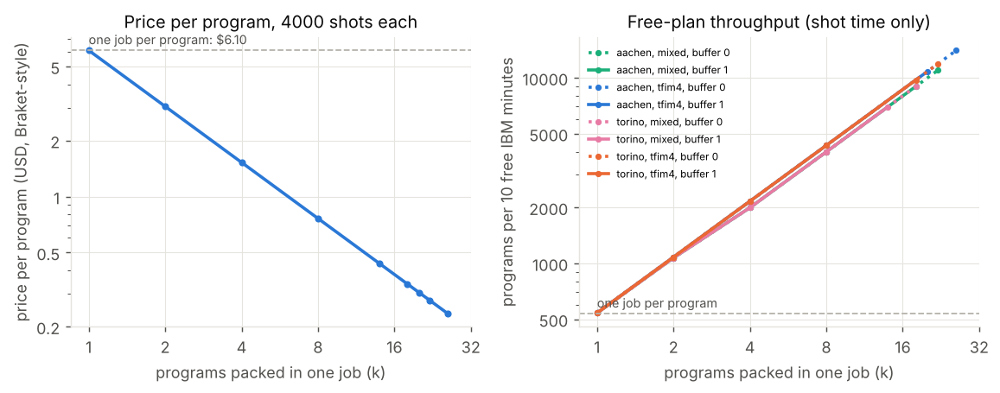

## A10. Batching and hedged race mode in simulation (E7)

800 tasks x 3 seeds per row; QPU figures are the hypothetical future QPU of E3. `-allfit` is the strict rule (all members side by side or all back to back); plain batch rows pack the subset that fits and run the rest back to back. Packing is assumed to cost no fidelity here.

| scenario | variant | qpu_tasks_per_run | qpu_jobs_per_run | mean_batch_size | qpu_cost_per_qpu_task | d_qpu_cost_per_qpu_task_pct | deadline_hit_rate | d_deadline_hit_pp | qpu_deadline_hit_rate | qpu_mean_latency_s | hedge_rate | fallback_win_rate | wasted_cost_usd_per_task | wasted_energy_j_per_task |
|---|---|---|---|---|---|---|---|---|---|---|---|---|---|---|
| future_qpu | adaptive | 15 | 15 | 1 | 2.93 | 0 | 0.9454 | 0 | 1 | 34.57 | 0 | - | 0 | 0 |
| future_qpu | adaptive+batch5 | 15 | 14.67 | 1.023 | 2.929 | -0.02275 | 0.9454 | 0 | 1 | 35.06 | 0 | - | 0 | 0 |
| future_qpu | adaptive+batch30 | 15 | 13 | 1.154 | 2.926 | -0.1365 | 0.9454 | 0 | 1 | 56.36 | 0 | - | 0 | 0 |
| future_qpu | adaptive+batch120 | 13.33 | 10 | 1.333 | 2.705 | -7.679 | 0.9437 | -0.1667 | 0.975 | 137.4 | 0 | - | 0 | 0 |
| future_qpu | adaptive+batch5-allfit | 15 | 14.67 | 1.023 | 2.929 | -0.02275 | 0.9454 | 0 | 1 | 35.06 | 0 | - | 0 | 0 |
| future_qpu | adaptive+batch30-allfit | 15 | 13 | 1.154 | 2.926 | -0.1365 | 0.9454 | 0 | 1 | 56.36 | 0 | - | 0 | 0 |
| future_qpu | adaptive+batch120-allfit | 13.33 | 10 | 1.333 | 2.85 | -2.73 | 0.9437 | -0.1667 | 0.975 | 138.4 | 0 | - | 0 | 0 |
| future_qpu | adaptive+batch30-seq | 15 | 13 | 1.154 | 2.926 | -0.1365 | 0.9454 | 0 | 1 | 56.36 | 0 | - | 0 | 0 |
| future_qpu | adaptive+batch30-blind | 15 | 13 | 1.154 | 2.926 | -0.1365 | 0.9454 | 0 | 1 | 56.36 | 0 | - | 0 | 0 |
| future_qpu | hedged | 15 | 15 | 1 | 2.93 | 0 | 0.9454 | 0 | 1 | 34.57 | 0 | - | 0 | 0 |
| future_qpu_busy | adaptive | 8.667 | 8.667 | 1 | 2.93 | 0 | 0.94 | 0 | 0.7692 | 881.2 | 0 | - | 0 | 0 |
| future_qpu_busy | adaptive+batch5 | 8 | 7.667 | 1.043 | 2.929 | -0.04266 | 0.9404 | 0.04167 | 0.75 | 935 | 0 | - | 0 | 0 |
| future_qpu_busy | adaptive+batch30 | 7.333 | 7 | 1.048 | 2.929 | -0.04654 | 0.94 | 0 | 0.7273 | 1017 | 0 | - | 0 | 0 |
| future_qpu_busy | adaptive+batch120 | 6 | 5.333 | 1.125 | 2.766 | -5.612 | 0.9408 | 0.08333 | 0.7778 | 1034 | 0 | - | 0 | 0 |
| future_qpu_busy | adaptive+batch5-allfit | 8 | 7.667 | 1.043 | 2.929 | -0.04266 | 0.9404 | 0.04167 | 0.75 | 935 | 0 | - | 0 | 0 |
| future_qpu_busy | adaptive+batch30-allfit | 7.333 | 7 | 1.048 | 2.929 | -0.04654 | 0.94 | 0 | 0.7273 | 1017 | 0 | - | 0 | 0 |
| future_qpu_busy | adaptive+batch120-allfit | 6 | 5.333 | 1.125 | 2.766 | -5.612 | 0.9408 | 0.08333 | 0.7778 | 1034 | 0 | - | 0 | 0 |
| future_qpu_busy | adaptive+batch30-seq | 7.333 | 7 | 1.048 | 2.929 | -0.04654 | 0.94 | 0 | 0.7273 | 1017 | 0 | - | 0 | 0 |
| future_qpu_busy | adaptive+batch30-blind | 9 | 8.333 | 1.08 | 2.928 | -0.07584 | 0.9396 | -0.04167 | 0.7407 | 922.7 | 0 | - | 0 | 0 |
| future_qpu_busy | hedged | 9.333 | 9.333 | 1 | 2.407 | -17.86 | 0.9413 | 0.125 | 0.8929 | 568.1 | 0.6071 | 0.2941 | 9.936e-05 | 43.17 |
| future_qpu_heavy_tail | adaptive | 15 | 15 | 1 | 2.93 | 0 | 0.9483 | 0 | 0.9778 | 29.7 | 0 | - | 0 | 0 |
| future_qpu_heavy_tail | adaptive+batch5 | 15 | 14.67 | 1.023 | 2.929 | -0.02275 | 0.9483 | 0 | 0.9778 | 30.07 | 0 | - | 0 | 0 |
| future_qpu_heavy_tail | adaptive+batch30 | 15 | 13 | 1.154 | 2.926 | -0.1365 | 0.9483 | 0 | 0.9778 | 51.67 | 0 | - | 0 | 0 |
| future_qpu_heavy_tail | adaptive+batch120 | 13.33 | 10 | 1.333 | 2.705 | -7.679 | 0.9475 | -0.08333 | 1 | 132.1 | 0 | - | 0 | 0 |
| future_qpu_heavy_tail | adaptive+batch5-allfit | 15 | 14.67 | 1.023 | 2.929 | -0.02275 | 0.9483 | 0 | 0.9778 | 30.07 | 0 | - | 0 | 0 |
| future_qpu_heavy_tail | adaptive+batch30-allfit | 15 | 13 | 1.154 | 2.926 | -0.1365 | 0.9483 | 0 | 0.9778 | 51.67 | 0 | - | 0 | 0 |
| future_qpu_heavy_tail | adaptive+batch120-allfit | 13.33 | 10 | 1.333 | 2.85 | -2.73 | 0.9475 | -0.08333 | 1 | 133 | 0 | - | 0 | 0 |
| future_qpu_heavy_tail | adaptive+batch30-seq | 15 | 13 | 1.154 | 2.926 | -0.1365 | 0.9483 | 0 | 0.9778 | 51.67 | 0 | - | 0 | 0 |
| future_qpu_heavy_tail | adaptive+batch30-blind | 15 | 13 | 1.154 | 2.926 | -0.1365 | 0.9483 | 0 | 0.9778 | 51.67 | 0 | - | 0 | 0 |
| future_qpu_heavy_tail | hedged | 15 | 15 | 1 | 2.93 | 0 | 0.9483 | 0 | 0.9778 | 29.7 | 0 | - | 0 | 0 |
| quantum_heavy_future | adaptive | 54.67 | 54.67 | 1 | 2.93 | 0 | 0.9663 | 0 | 0.9817 | 30.38 | 0 | - | 0 | 0 |
| quantum_heavy_future | adaptive+batch5 | 54.33 | 45 | 1.207 | 2.765 | -5.641 | 0.9658 | -0.04167 | 0.9816 | 31.24 | 0 | - | 0 | 0 |
| quantum_heavy_future | adaptive+batch30 | 53 | 23 | 2.304 | 2.384 | -18.63 | 0.9646 | -0.1667 | 0.9937 | 50.87 | 0 | - | 0 | 0 |
| quantum_heavy_future | adaptive+batch120 | 50.33 | 9.667 | 5.207 | 2.099 | -28.36 | 0.9629 | -0.3333 | 0.9934 | 108.5 | 0 | - | 0 | 0 |
| quantum_heavy_future | adaptive+batch5-allfit | 54.33 | 45 | 1.207 | 2.8 | -4.426 | 0.9658 | -0.04167 | 0.9816 | 31.63 | 0 | - | 0 | 0 |
| quantum_heavy_future | adaptive+batch30-allfit | 53 | 23 | 2.304 | 2.712 | -7.427 | 0.9646 | -0.1667 | 0.9937 | 53.71 | 0 | - | 0 | 0 |
| quantum_heavy_future | adaptive+batch120-allfit | 49.67 | 9.667 | 5.138 | 2.886 | -1.489 | 0.9625 | -0.375 | 0.9933 | 119.1 | 0 | - | 0 | 0 |
| quantum_heavy_future | adaptive+batch30-seq | 52.33 | 22.33 | 2.343 | 2.913 | -0.5869 | 0.9646 | -0.1667 | 1 | 54.68 | 0 | - | 0 | 0 |
| quantum_heavy_future | adaptive+batch30-blind | 52.67 | 22.33 | 2.358 | 2.38 | -18.76 | 0.9646 | -0.1667 | 0.9937 | 51.05 | 0 | - | 0 | 0 |
| quantum_heavy_future | hedged | 54.67 | 54.67 | 1 | 2.93 | 0 | 0.9663 | 0 | 0.9817 | 30.38 | 0 | - | 0 | 0 |
| future_qpu | hedged+batch120 | 13.33 | 10 | 1.333 | 2.705 | -7.679 | 0.9437 | -0.1667 | 0.975 | 137.4 | 0 | - | 0 | 0 |
| future_qpu_busy | hedged+batch120 | 6 | 5.333 | 1.125 | 2.442 | -16.67 | 0.9417 | 0.1667 | 0.8889 | 861.6 | 0.4444 | 0.25 | 4.867e-05 | 20.79 |
| future_qpu_heavy_tail | hedged+batch120 | 13.33 | 10 | 1.333 | 2.705 | -7.679 | 0.9475 | -0.08333 | 1 | 132.1 | 0 | - | 0 | 0 |
| quantum_heavy_future | hedged+batch120 | 50.33 | 9.667 | 5.207 | 2.099 | -28.36 | 0.9629 | -0.3333 | 0.9934 | 108.5 | 0 | - | 0 | 0 |

On `baseline` every variant gives the same result (no task reaches the QPU).


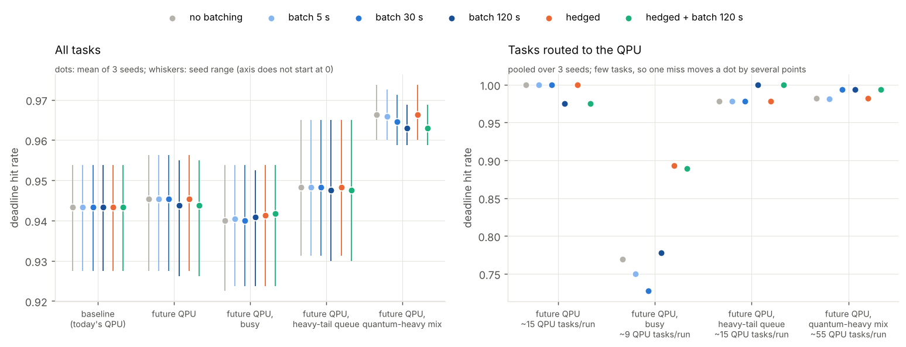

## A11. Live race mode (E7)

Real orchestrator, QPU path forced onto `ibm-auto` (local emulator of the best snapshot device), classical fallback run at the same time. Times are wall-clock seconds from submission.

| scenario | run | deadline_s | fallback | winner | quantum_status | delivered_s | overshoot_s | classical_wall_s | quantum_wall_s | qpu_ran_before_cancel_s | delivered_quality |
|---|---|---|---|---|---|---|---|---|---|---|---|
| qsim_short | 0 | 3 | edge_gpu | classical | cancelled | 3.005 | 0.005497 | 0.06559 | 6.033 | 2.948 | 1 |
| qsim_long | 0 | 60 | edge_gpu | quantum | completed | 6.744 | 0 | 0.07131 | 6.744 | - | 0.9849 |
| qsim_long_warm | 0 | 5 | edge_gpu | quantum | completed | 1.719 | 0 | 0.06069 | 1.719 | - | 0.9868 |
| qaoa_mid | 0 | 15 | edge_cpu | classical | cancelled | 15.02 | 0.02299 | 0.07878 | 16.47 | 14.97 | 1 |
| qaoa_repeat | 0 | 6 | edge_cpu | classical | cancelled | 6.035 | 0.03537 | 0.074 | 7.36 | 5.978 | 1 |
| qaoa_repeat | 1 | 6 | edge_gpu | classical | cancelled | 6.009 | 0.009483 | 0.0713 | 7.202 | 5.953 | 1 |
| qaoa_repeat | 2 | 6 | edge_gpu | classical | cancelled | 6.007 | 0.007262 | 0.07007 | 6.862 | 5.951 | 1 |
| qaoa_repeat | 3 | 6 | edge_cpu | classical | cancelled | 6.005 | 0.005453 | 0.07763 | 7.435 | 5.948 | 1 |
| qaoa_repeat | 4 | 6 | edge_cpu | classical | cancelled | 6.547 | 0.5469 | 0.07039 | 6.578 | 6.49 | 1 |
| qaoa_repeat | 5 | 6 | edge_cpu | classical | cancelled | 6.15 | 0.15 | 0.07003 | 6.184 | 6.095 | 1 |

How late a timed 50 ms wait wakes up (ms), idle vs while the emulator runs in another thread on the same machine:

| condition | samples | median | p95 | max |
|---|---|---|---|---|
| emulator running | 180 | 5.46 | 735.6 | 861.1 |
| idle | 60 | 0.1677 | 0.3827 | 0.639 |

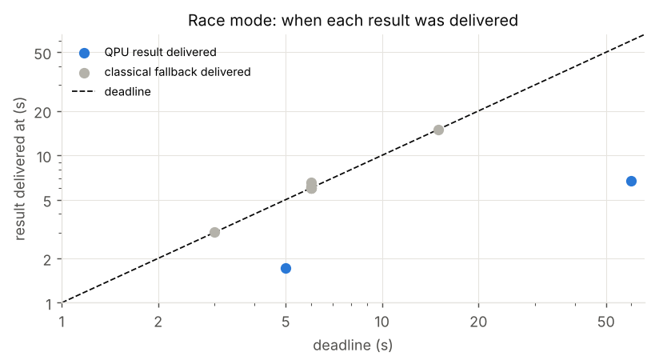

## A12. VQE ground-state energy (E8)

Energy quality = 1 - (E - E0)/(Emax - E0): 1 at the exact ground state, about 0.5 for a fully mixed (pure noise) state. Mean over seeds:

| model | n | exact_diagonalisation | vqe_cobyla_noiseless | vqe_ibm_emulator | vqe_noiseless | vqe_noisy |
|---|---|---|---|---|---|---|
| h2 | 2 | 1.0000 | 0.9199 | 0.8905 | 0.9957 | 0.9987 |
| tfim | 4 | 1.0000 | 0.9556 | 0.9035 | 0.9816 | 0.9804 |
| tfim | 6 | 1.0000 | 0.9594 | - | 0.9839 | 0.9813 |
| tfim | 8 | 1.0000 | 0.9315 | - | 0.9860 | 0.9743 |
| tfim | 10 | 1.0000 | 0.9080 | - | 0.9708 | 0.9719 |

H2 error in mHa (chemical accuracy is 1.6 mHa):

| method | mean | min | max |
|---|---|---|---|
| vqe_cobyla_noiseless | 130.73 | 23.06 | 340.50 |
| vqe_ibm_emulator | 178.80 | 178.80 | 178.80 |
| vqe_noiseless | 6.71 | -1.08 | 17.22 |
| vqe_noisy | 1.33 | -2.15 | 6.27 |

H2 with VQE on every stack:

| stack | model | energy | error_mHa | quality | circuit_evals | time_s |
|---|---|---|---|---|---|---|
| qiskit | h2 | -1.8620 | -4.6842 | 1.0000 | 90 | 2.1009 |
| pennylane | h2 | -1.8610 | -3.6950 | 1.0000 | 90 | 0.9769 |
| cirq | h2 | -1.8554 | 1.8713 | 0.9989 | 90 | 1.3371 |
| braket-local | h2 | -1.8586 | -1.3742 | 1.0000 | 90 | 3.3965 |


## A13. Edge/cloud task scheduling: QAOA vs classical (E8)

Mean optimum / cost found (1 = optimal assignment):

| n | exact | greedy | qaoa_ibm_emulator | qaoa_noiseless | qaoa_noisy | random_sampling | random_sampling_1000 | simulated_annealing |
|---|---|---|---|---|---|---|---|---|
| 4 | 1.000 | 0.770 | 1.000 | 1.000 | 1.000 | 1.000 | 1.000 | 1.000 |
| 6 | 1.000 | 0.662 | 1.000 | 1.000 | 1.000 | 1.000 | 1.000 | 1.000 |
| 8 | 1.000 | 0.715 | 1.000 | 1.000 | 1.000 | 1.000 | 1.000 | 1.000 |
| 10 | 1.000 | 0.686 | - | 1.000 | 1.000 | 1.000 | 1.000 | 1.000 |
| 12 | 1.000 | 0.640 | - | 1.000 | 1.000 | 1.000 | 0.893 | 1.000 |
| 14 | 1.000 | 0.820 | - | 1.000 | 1.000 | 1.000 | 0.861 | 1.000 |

`random_sampling` draws as many uniform samples as the noiseless QAOA run measured in total (about 38 circuits x 1000 shots), because QAOA keeps the best sample it ever saw; `random_sampling_1000` draws 1000.


Mean cost of a single sample (optimum / mean cost); best-of-shots hides this:

| n | qaoa_noiseless | qaoa_noisy | random_sampling |
|---|---|---|---|
| 4 | 0.271 | 0.288 | 0.201 |
| 6 | 0.184 | 0.185 | 0.188 |
| 8 | 0.410 | 0.356 | 0.306 |
| 10 | 0.262 | 0.266 | 0.262 |
| 12 | 0.287 | 0.287 | 0.280 |
| 14 | 0.378 | 0.381 | 0.379 |

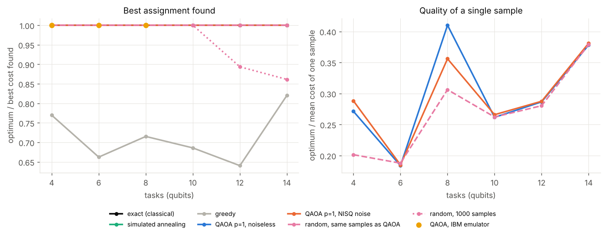

## A14. Split model: classifier heads (E9)

Test accuracy on the same 360 digit images, mean and std over training seeds (the data split is fixed). `quantum_l0` is the quantum head with no trainable layers (encoding + readout).

| mode | k | linear | mlp | quantum | quantum_l0 |
|---|---|---|---|---|---|
| end-to-end | 4 | 0.954 | 0.890 | 0.843 | 0.941 |
| end-to-end | 8 | 0.975 | 0.963 | 0.923 | 0.975 |
| transfer | 2 | 0.693 | 0.647 | 0.630 | 0.636 |
| transfer | 3 | 0.868 | 0.854 | 0.854 | 0.850 |
| transfer | 4 | 0.950 | 0.944 | 0.931 | 0.948 |
| transfer | 5 | 0.965 | 0.951 | 0.910 | 0.960 |
| transfer | 6 | 0.969 | 0.959 | 0.930 | 0.968 |
| transfer | 7 | 0.966 | 0.960 | 0.901 | 0.960 |
| transfer | 8 | 0.975 | 0.963 | 0.919 | 0.969 |

Paired differences per seed (positive = first head better):

| mode | k | difference | mean | min | max | seeds_a_better | seeds |
|---|---|---|---|---|---|---|---|
| transfer | 2 | quantum - linear | -0.063 | -0.103 | -0.042 | 0 | 3 |
| transfer | 2 | quantum - quantum_l0 | -0.006 | -0.014 | 0.000 | 0 | 3 |
| transfer | 3 | quantum - linear | -0.014 | -0.033 | 0.011 | 1 | 3 |
| transfer | 3 | quantum - quantum_l0 | 0.004 | -0.019 | 0.019 | 2 | 3 |
| transfer | 4 | quantum - linear | -0.019 | -0.025 | -0.011 | 0 | 3 |
| transfer | 4 | quantum - quantum_l0 | -0.017 | -0.019 | -0.014 | 0 | 3 |
| transfer | 5 | quantum - linear | -0.055 | -0.083 | -0.028 | 0 | 3 |
| transfer | 5 | quantum - quantum_l0 | -0.050 | -0.081 | -0.025 | 0 | 3 |
| transfer | 6 | quantum - linear | -0.040 | -0.047 | -0.033 | 0 | 3 |
| transfer | 6 | quantum - quantum_l0 | -0.038 | -0.042 | -0.033 | 0 | 3 |
| transfer | 7 | quantum - linear | -0.065 | -0.075 | -0.050 | 0 | 3 |
| transfer | 7 | quantum - quantum_l0 | -0.059 | -0.072 | -0.044 | 0 | 3 |
| transfer | 8 | quantum - linear | -0.056 | -0.067 | -0.047 | 0 | 3 |
| transfer | 8 | quantum - quantum_l0 | -0.050 | -0.067 | -0.042 | 0 | 3 |
| end-to-end | 4 | quantum - linear | -0.111 | -0.236 | -0.028 | 0 | 3 |
| end-to-end | 4 | quantum - quantum_l0 | -0.098 | -0.247 | 0.008 | 1 | 3 |
| end-to-end | 8 | quantum - linear | -0.052 | -0.094 | -0.022 | 0 | 3 |
| end-to-end | 8 | quantum - quantum_l0 | -0.052 | -0.097 | -0.011 | 0 | 3 |


## A15. Split model: what the transmitted tensor reveals (E9)

Strongest of ridge, MLP and kNN decoders, over 3 seeds. `reid` = share of the 360 test images whose reconstruction is nearest to its own original (chance 1/360, label alone 0.028). The policy limit is 5 images beyond the label (an assumption). Against these attacks only; not a guarantee.

| k | cut | reid_mean | reid_max | reid_beyond_label_images_max | r2_beyond_label_max | private_ok_any_seed | strongest_reid |
|---|---|---|---|---|---|---|---|
| 2 | input | 1.000 | 1.000 | 350 | 0.581 | False | ridge |
| 2 | conv1 | 1.000 | 1.000 | 350 | 0.527 | False | ridge |
| 2 | conv2 | 0.834 | 0.842 | 293 | 0.354 | False | mlp |
| 2 | embedding | 0.034 | 0.039 | 13 | -0.090 | False | knn/mlp |
| 3 | input | 1.000 | 1.000 | 350 | 0.581 | False | ridge |
| 3 | conv1 | 1.000 | 1.000 | 350 | 0.528 | False | ridge |
| 3 | conv2 | 0.878 | 0.906 | 316 | 0.373 | False | mlp/ridge |
| 3 | embedding | 0.051 | 0.067 | 21 | 0.019 | False | knn |
| 4 | input | 1.000 | 1.000 | 350 | 0.581 | False | ridge |
| 4 | conv1 | 1.000 | 1.000 | 350 | 0.525 | False | ridge |
| 4 | conv2 | 0.898 | 0.917 | 320 | 0.389 | False | mlp/ridge |
| 4 | embedding | 0.083 | 0.106 | 35 | 0.058 | False | knn |
| 5 | input | 1.000 | 1.000 | 350 | 0.581 | False | ridge |
| 5 | conv1 | 1.000 | 1.000 | 350 | 0.533 | False | ridge |
| 5 | conv2 | 0.881 | 0.892 | 311 | 0.374 | False | mlp/ridge |
| 5 | embedding | 0.081 | 0.094 | 30 | 0.065 | False | knn |
| 6 | input | 1.000 | 1.000 | 350 | 0.581 | False | ridge |
| 6 | conv1 | 1.000 | 1.000 | 350 | 0.532 | False | ridge |
| 6 | conv2 | 0.902 | 0.925 | 323 | 0.393 | False | mlp/ridge |
| 6 | embedding | 0.103 | 0.131 | 44 | 0.105 | False | knn |
| 7 | input | 1.000 | 1.000 | 350 | 0.581 | False | ridge |
| 7 | conv1 | 1.000 | 1.000 | 350 | 0.532 | False | ridge |
| 7 | conv2 | 0.891 | 0.925 | 323 | 0.396 | False | ridge |
| 7 | embedding | 0.128 | 0.144 | 49 | 0.133 | False | knn |
| 8 | input | 1.000 | 1.000 | 350 | 0.581 | False | ridge |
| 8 | conv1 | 1.000 | 1.000 | 350 | 0.531 | False | ridge |
| 8 | conv2 | 0.920 | 0.922 | 322 | 0.401 | False | ridge |
| 8 | embedding | 0.136 | 0.153 | 52 | 0.126 | False | knn |


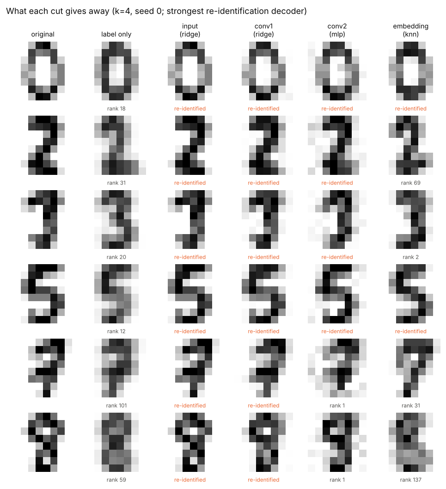

## A16. Split model: quantum head on devices, and the router (E9)

Seed-0 quantum head on all 360 test images, 1000 shots. `ibm-auto` is the calibration-chosen IBM device emulated from its snapshot; packed paths share one job between several images. Price uses the Braket-style figures in the catalogue (an assumption). `modelled_quality` is the cost model's prediction.

| k | path | device | accuracy | agreement_with_exact | jobs | qpu_s | price_usd | modelled_quality | wall_s |
|---|---|---|---|---|---|---|---|---|---|
| 4 | exact | - | 0.9444 | 1 | - | - | - | 0.9128 | - |
| 4 | sampled 100 shots | - | 0.9361 | 0.9833 | - | - | - | 0.9128 | - |
| 4 | sampled 1000 shots | - | 0.9444 | 1 | - | - | - | 0.9128 | - |
| 4 | ibm-auto (emulated) | fake_aachen | 0.9444 | 1 | 360 | 105.2 | 630 | 0.9128 | 12.59 |
| 4 | packed 8 per job | fake_aachen | 0.9444 | 0.9972 | 45 | 13 | 78.75 | 0.9128 | 130.7 |
| 4 | packed 16 per job | fake_aachen | 0.9417 | 0.9944 | 23 | 6.646 | 40.25 | 0.9128 | 51.21 |
| 8 | exact | - | 0.9222 | 1 | - | - | - | 0.8521 | - |
| 8 | sampled 100 shots | - | 0.8917 | 0.925 | - | - | - | 0.8521 | - |
| 8 | sampled 1000 shots | - | 0.925 | 0.975 | - | - | - | 0.8521 | - |
| 8 | ibm-auto (emulated) | fake_aachen | 0.925 | 0.9861 | 360 | 117.1 | 630 | 0.8521 | 751.2 |
| 8 | packed 8 per job | fake_aachen | 0.9167 | 0.9722 | 60 | 18.99 | 105 | 0.8521 | 829.8 |

Router decisions (each row covers 60 conditions: 2 profiles x 3 edge devices x 5 uplinks x 2 batch sizes). `qhead_equal` assumes the quantum head as accurate as the best classical head; `_private` also treats the embedding as private; `future` is a 100x better, 10x cheaper QPU. All three are what-ifs, not measurements.

| policy | qpu | whatif | privacy | deadline | edge only | split to cloud | cloud (raw input) | quantum head (QPU) | quantum head (simulator) | gate_qpu_open | most_common_qpu_gate_failure |
|---|---|---|---|---|---|---|---|---|---|---|---|
| qedge_static | today | measured | False | real-time | 48 | 0 | 12 | 0 | 0 | 0 | expected quality gain; meets deadline |
| qedge_static | future | measured | False | real-time | 48 | 0 | 12 | 0 | 0 | 0 | expected quality gain; meets deadline |
| qedge_static | today | measured | False | batch job | 44 | 0 | 16 | 0 | 0 | 0 | expected quality gain |
| qedge_static | future | measured | False | batch job | 44 | 0 | 16 | 0 | 0 | 0 | expected quality gain |
| qedge_static | today | measured | True | real-time | 60 | 0 | 0 | 0 | 0 | 0 | data may leave edge; expected quality gain; meets deadline |
| qedge_static | future | measured | True | real-time | 60 | 0 | 0 | 0 | 0 | 0 | data may leave edge; expected quality gain; meets deadline |
| qedge_static | today | measured | True | batch job | 60 | 0 | 0 | 0 | 0 | 0 | data may leave edge; expected quality gain |
| qedge_static | future | measured | True | batch job | 60 | 0 | 0 | 0 | 0 | 0 | data may leave edge; expected quality gain |
| qedge_static | today | qhead_equal | False | real-time | 48 | 0 | 12 | 0 | 0 | 0 | expected quality gain; meets deadline |
| qedge_static | future | qhead_equal | False | real-time | 48 | 0 | 12 | 0 | 0 | 0 | meets deadline |
| qedge_static | today | qhead_equal | False | batch job | 44 | 0 | 16 | 0 | 0 | 0 | expected quality gain |
| qedge_static | future | qhead_equal | False | batch job | 44 | 0 | 16 | 0 | 0 | 60 | - |
| qedge_static | today | qhead_equal | True | real-time | 60 | 0 | 0 | 0 | 0 | 0 | data may leave edge; expected quality gain; meets deadline |
| qedge_static | future | qhead_equal | True | real-time | 60 | 0 | 0 | 0 | 0 | 0 | data may leave edge; meets deadline |
| qedge_static | today | qhead_equal | True | batch job | 60 | 0 | 0 | 0 | 0 | 0 | data may leave edge; expected quality gain |
| qedge_static | future | qhead_equal | True | batch job | 60 | 0 | 0 | 0 | 0 | 0 | data may leave edge |
| qedge_static | today | qhead_equal_private | False | real-time | 48 | 0 | 12 | 0 | 0 | 0 | expected quality gain; meets deadline |
| qedge_static | future | qhead_equal_private | False | real-time | 48 | 0 | 12 | 0 | 0 | 0 | meets deadline |
| qedge_static | today | qhead_equal_private | False | batch job | 44 | 0 | 16 | 0 | 0 | 0 | expected quality gain |
| qedge_static | future | qhead_equal_private | False | batch job | 44 | 0 | 16 | 0 | 0 | 60 | - |
| qedge_static | today | qhead_equal_private | True | real-time | 60 | 0 | 0 | 0 | 0 | 0 | expected quality gain; meets deadline |
| qedge_static | future | qhead_equal_private | True | real-time | 60 | 0 | 0 | 0 | 0 | 0 | meets deadline |
| qedge_static | today | qhead_equal_private | True | batch job | 60 | 0 | 0 | 0 | 0 | 0 | expected quality gain |
| qedge_static | future | qhead_equal_private | True | batch job | 60 | 0 | 0 | 0 | 0 | 60 | - |

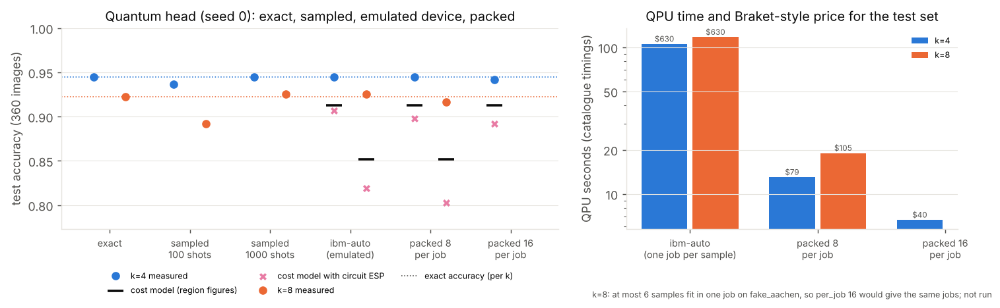

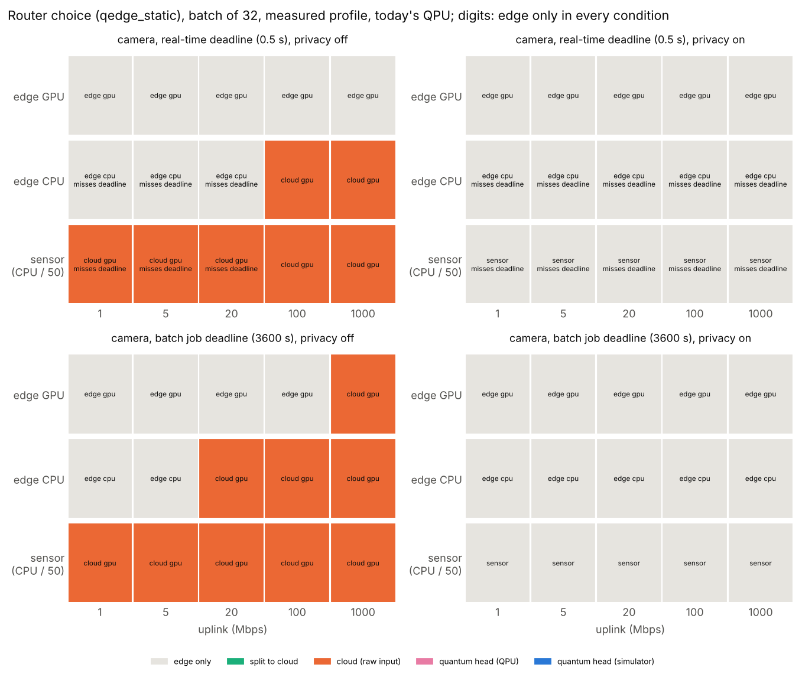

